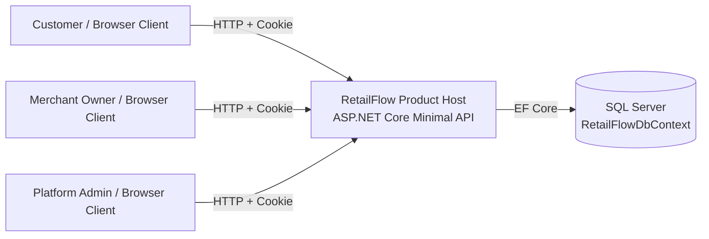
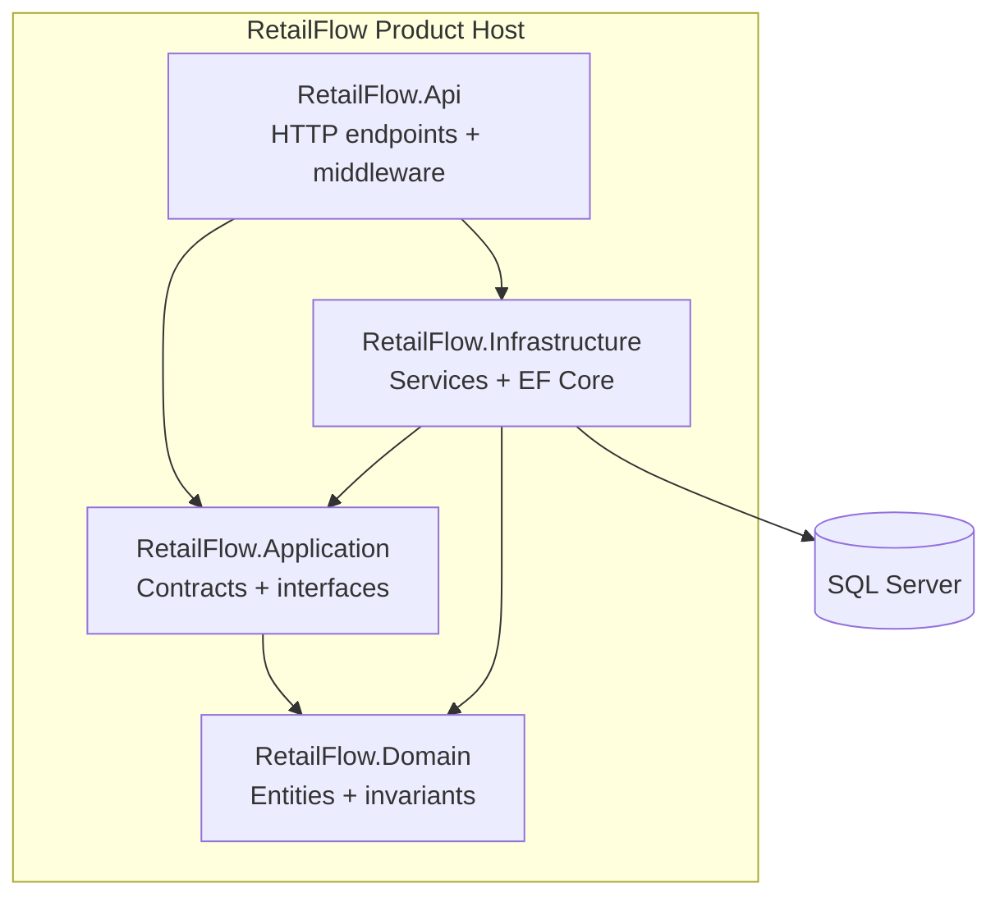
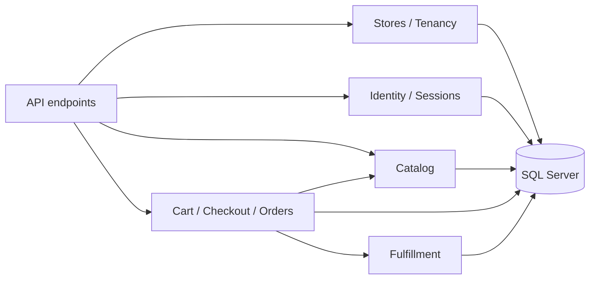
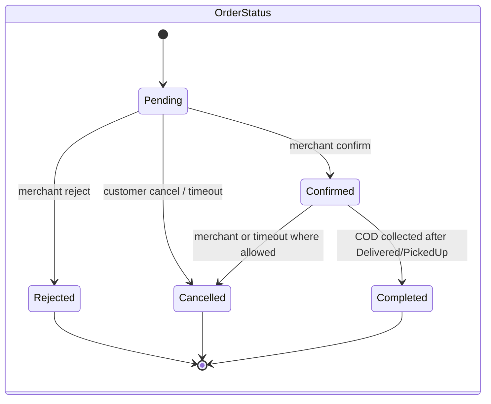
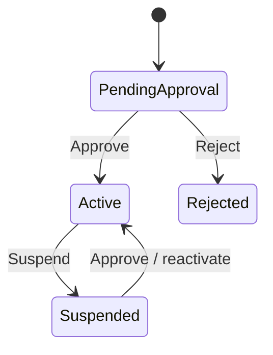

# مخططات المعمارية والتدفقات

المخططات التالية تصف المسارات الظاهرة في Product Host عند baseline. تم استخدام C4 للمكونات الثابتة، وSequence/State diagrams للتدفقات والسلوك.

## System Context (C4 Level 1)



لا يُرسم Frontend مستقل لأن شجرة هذا commit لا تحتوي تطبيق Client منفصل.

## Container / Project View (C4 Level 2 style)



## Module View



## Customer checkout sequence (observed)

```mermaid
sequenceDiagram
  actor Customer
  participant API as CustomerOrderEndpoints
  participant Checkout as CheckoutService
  participant DB as SQL Server
  Customer->>API: POST /checkout + Idempotency-Key
  API->>Checkout: CheckoutAsync(storeId, customerId, key, command)
  Checkout->>DB: Read Cart
  Checkout->>Checkout: Compute SHA-256 request hash
  Checkout->>DB: Insert CheckoutRequest(InProgress) + SaveChanges
  alt Unique key collision
    Checkout->>DB: Load existing key
    Checkout-->>API: Replayed / Conflict / PayloadMismatch / Failed
  else Key claim acquired
    Checkout->>DB: Load Store, Zone, Products, Inventory
    Checkout->>Checkout: Reserve inventory; create Order + OrderItems
    Checkout->>DB: Save order, inventory, clear cart, mark claim Completed
    Checkout-->>API: Created order
  end
  API-->>Customer: 201 / 200 / 409 / 422 / 400
```

## Order lifecycle (separate axes)



FulfillmentStatus is tracked separately from OrderStatus. The domain transition rules are in `Order.AdvanceFulfillment`; do not merge them into one state machine.

## Store Lifecycle



**Source anchors:** `Store.cs`, `Order.cs`, `CheckoutService.cs`, `ProductHostExtensions.cs`, endpoint modules.
