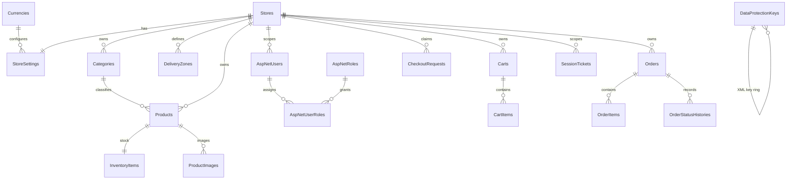

# معمارية قاعدة البيانات

## 1. التقنية والسياق

Product Host يستخدم EF Core SQL Server provider من package version `10.0.15` مع `RetailFlowDbContext`. جميع الجداول الأساسية موجودة في قاعدة بيانات واحدة يختارها `ConnectionStringResolver`، والاتصال runtime يعتمد على `RETAILFLOW_CONNECTION` أو `ConnectionStrings:RetailFlow`، مع fallback محلي في Development فقط.

## 2. الكيانات والجداول

المخطط توضيحي للعلاقات العامة؛ راجع EF configurations وmigrations لتفاصيل المفاتيح المركبة والـ delete behaviors.

## 3. Tenant isolation في البيانات

تستخدم عدة كيانات Alternate Key مركباً مثل `(StoreId, Id)`، وتستخدم العلاقات من النوع `(StoreId, ProductId)` أو `(StoreId, OrderId)` لضمان أن child record لا يرتبط بكيان من متجر آخر. كما توجد unique indexes مثل:

- `UX_Stores_Slug`
- `UX_StoreSettings_StoreId`
- `UX_Categories_StoreId_Slug`
- `UX_Products_StoreId_Sku` (filtered على SKU غير null)
- `UX_InventoryItems_StoreId_ProductId`
- `UX_DeliveryZones_StoreId_NormalizedName`
- `UX_Carts_StoreId_CustomerId`
- `UX_CartItems_StoreId_CartId_ProductId`
- `UX_CheckoutRequests_StoreId_CustomerId_IdempotencyKey`
- `UX_Orders_StoreId_OrderNumber`

## 4. أنواع الضبط في SQL

- Check constraints لحالة Store/Order/Product وبعض القيم غير السالبة والكميات.
- `decimal(19,4)` للأسعار والإجماليات ورسوم التوصيل.
- `datetimeoffset(3)` أو precision 3 للتواريخ الزمنية في أغلب الجداول.
- SQL Server `rowversion` على `InventoryItem`, `Order`, `Cart`, و`CartItem` (وفق EF configurations).
- `Restrict` delete behavior في علاقات أساسية لتجنب الحذف المتسلسل غير المقصود.

## 5. Concurrency

`InventoryItem.RowVersion` و`Order.RowVersion` معرفان كـ rowversion tokens. EF Core يستخدم optimistic concurrency؛ عند تحديث متزامن قد يظهر `DbUpdateConcurrencyException`. على التطبيق تحديد سياسة إعادة محاولة/إرجاع Conflict واضحة. مجرد إعداد RowVersion لا يثبت أن كل مسار يلتقط التعارض ويعالجه بشكل صحيح.

## 6. Transaction boundaries

EF Core يلف التغييرات داخل SaveChanges واحدة بtransaction عند استخدام provider علائقي. لكن العمليات التي تنفذ عدة SaveChanges أو عدة contexts ليست تلقائياً معاملة واحدة.

في `CheckoutService`:
- claim الأول (`CheckoutRequest`) يُحفظ في `SaveChangesAsync` أولى مع `ClaimToken` و`LeaseExpiresAtUtc` (`60s`).
- ثم تُفتح معاملة `ReadCommitted` صريحة تُقرأ فيها البيانات وتُنفذ تغييرات المخزون والطلب والسلة واكتمال claim (مع التحقق من `ClaimToken` و`LeaseExpiresAtUtc`)، وتُحفظ وتُعتمد (`CommitAsync`) معاً.

العملية الثانية تُحفظ وتُعتمد ذرياً داخل `BeginTransactionAsync(IsolationLevel.ReadCommitted)`، لكن سجل claim الأول خارجها. لا تكتب في وصف النظام أن كامل checkout (من claim إلى order) transaction واحدة.

## 7. النسخ الاحتياطي والاستعادة

لا يوجد في شجرة الكود أو CI runbook مثبت للنسخ الاحتياطي/الاستعادة أو RPO/RTO. هذه مسؤولية تشغيلية مفتوحة، وليست وظيفة يثبتها EF migrations.
