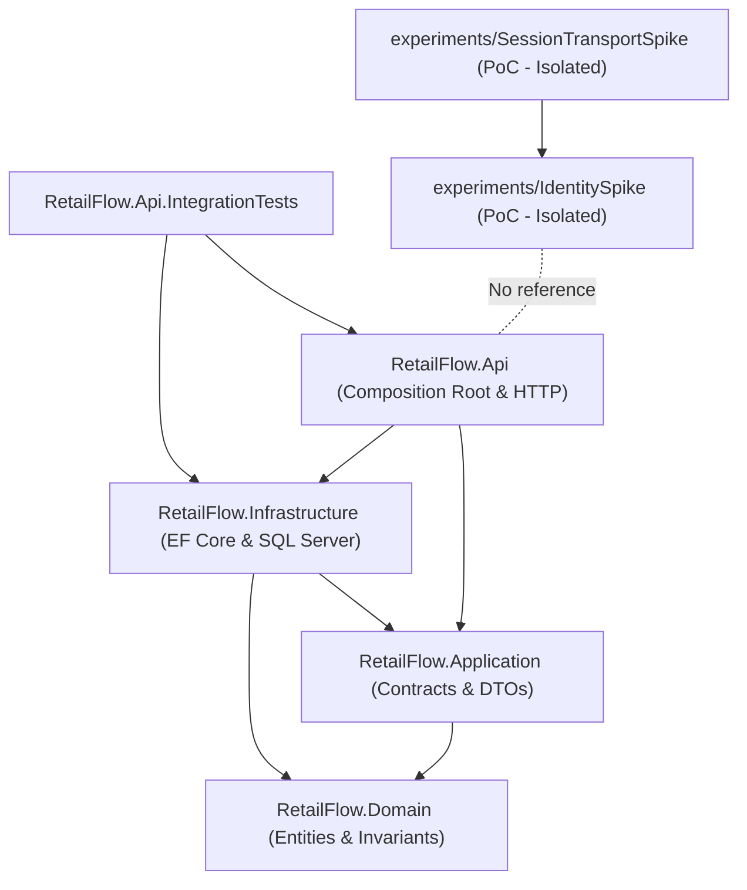
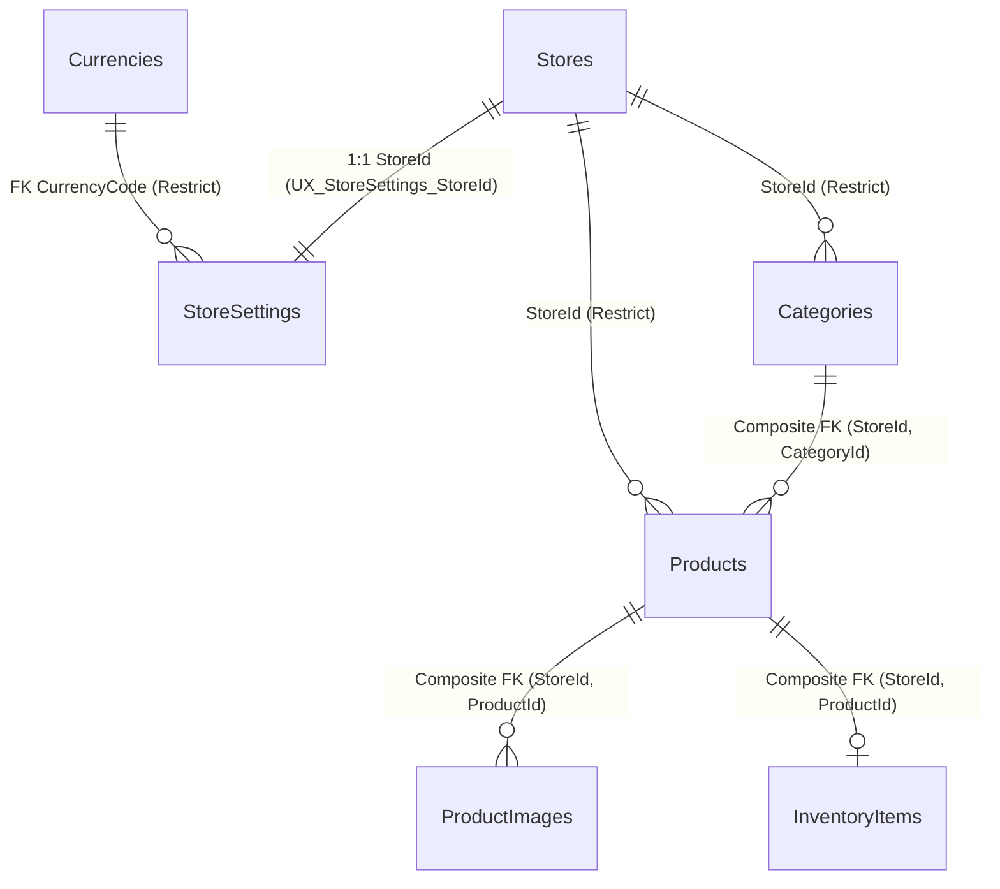
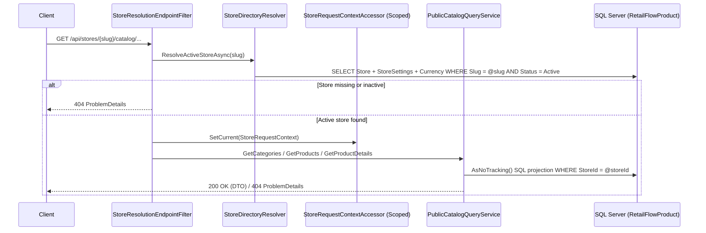
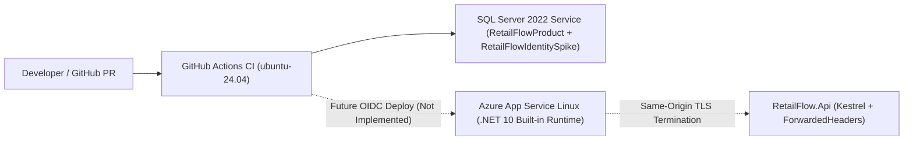

# System Architecture

**Last Verified:** `2026-11-26` | **Verified Commit:** `04392c875c275e99f4b5ee378f63b3a8b8fc541d`

## 1. Current State (As-Is) vs. Target State (To-Be)
- **As-Is:** Production solution (`RetailFlow.slnx`) is a Clean Architecture / Modular Monolith with 4 `src/` layers (`Domain`, `Application`, `Infrastructure`, `Api`) and 1 `tests/` project (`RetailFlow.Api.IntegrationTests`). Two experimental PoCs (`experiments/IdentitySpike/`, `experiments/SessionTransportSpike/`) remain completely isolated.
- **To-Be:** Add Merchant/Admin, Cart, Checkout/Orders, Fulfillment, React SPA (`wwwroot`), and integrated Identity/Session Transport once `AUTH-ADR-01` acceptance gates close.
- **Gap:** No authentication/authorization, no write endpoints, and no React frontend in `src/`.

## 2. Solution & Project Dependency Graph

- `RetailFlow.Domain` has zero NuGet or project dependencies.
- `RetailFlow.Application` references `RetailFlow.Domain` only (no EF Core, SQL Server, or ASP.NET Core packages).
- `RetailFlow.Infrastructure` implements `IStoreDirectoryResolver`, `IStoreRequestContextAccessor`, `IPublicCatalogQueryService`, and `RetailFlowDbContext`.
- `RetailFlow.Api` composes host middleware (`ProductHostExtensions`) and catalog endpoints (`PublicCatalogEndpoints`).

## 3. Domain & Database Entity Relationships (As-Is)

## 4. Public Catalog Request & Tenant Isolation Lifecycle

## 5. Deployment Architecture (As-Is CI vs. To-Be Azure)

