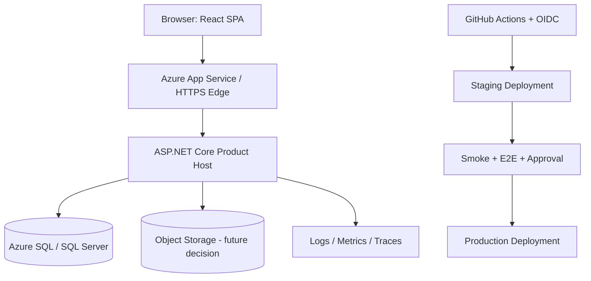

# RETAILFLOW
## دليل الهندسة والتوثيق الشامل - من A إلى Z

**الإصدار:** 2.0.0  
**التاريخ المرجعي:** 25 نوفمبر 2026  
**الحالة:** Engineering Baseline Draft - Requires Owner Review  
**المستودع:** https://github.com/ayhm325/RetailFlow  
**Commit baseline:** `04392c875c275e99f4b5ee378f63b3a8b8fc541d`

> هذا الدليل يفرق بين التنفيذ الموجود في Product Host، وإثبات المفهوم PoC، والتصميم المقترح، والقرارات المفتوحة. وجود مواصفة لا يعني أن الميزة منفذة، ووجود كيان أو جدول لا يعني اكتمال العملية التجارية.

---

# الجزء الأول: الحوكمة والمنتج والمتطلبات

# 00. حوكمة الوثائق وضبط الحالة

## 00.1 الغرض

هذه المجموعة هي المرجع الهندسي الموحد لـ RetailFlow، وتغطي دورة حياة المنتج من تعريف الرؤية والمتطلبات حتى المعمارية والتنفيذ والاختبار والنشر والتشغيل والصيانة. أُعدت اعتماداً على ملفات المشروع المرفقة، وفحص مصدر المستودع عند commit محدد، ومراجع هندسية رسمية ومهنية. وهي ليست شهادة ISO أو تقرير تدقيق خارجي.

## 00.2 Baseline الفعلي

- Repository: `ayhm325/RetailFlow`.
- Commit: `04392c875c275e99f4b5ee378f63b3a8b8fc541d`، بتاريخ 25 نوفمبر 2026.
- SDK: `.NET SDK 10.0.404` في `global.json`.
- Product projects: `RetailFlow.Api`, `RetailFlow.Application`, `RetailFlow.Domain`, `RetailFlow.Infrastructure`.
- Test project الظاهر في الحل: `RetailFlow.Api.IntegrationTests`.
- مشاريع PoC مستقلة: `experiments/IdentitySpike` و`experiments/SessionTransportSpike`.
- الـ Product Host يحتوي Public Store Catalog Read API وSQL Server/EF Core catalog slice وStore resolution وhealth checks وProblemDetails.
- لا يظهر في هذا snapshot React `ClientApp`، ولا تكامل Identity/Session داخل Product Host، ولا Merchant CRUD، ولا Customer profile، ولا Cart/Checkout/Orders، ولا Reservation workflow، ولا Deployment workflow للإنتاج.

**حدود الدليل:** فُحصت شجرة المصدر وملفات مختارة عبر GitHub. لم يتم تشغيل build أو tests من جديد خلال إعداد هذا الدليل. حالة GitHub commit status التي ظهرت عند المعاينة كانت `pending` دون check entries؛ لذلك لا يدعي الدليل أن هذا commit اجتاز CI.

## 00.3 وسوم الحالة

| الوسم | التعريف | قاعدة الادعاء |
|---|---|---|
| Implemented | كود منتج موجود في Product Host عند commit المرجعي | اذكر مسار الملف والاختبار عند توفره |
| PoC | موجود داخل تجربة مستقلة | لا يقدم على أنه ميزة في Product Host |
| Proposed | تصميم أو توصية لم تدمج أو لم تعتمد نهائياً | لا يُقال إنها تعمل |
| Open Decision | تحتاج قراراً من Product/Architecture/Security/Ops Owner | تبقى مانعاً للقرارات التابعة |
| Verified | يوجد دليل تشغيل/اختبار على commit وبيئة محددين | اذكر commit/run/environment لا وصفاً عاماً |

## 00.4 ترتيب حجية المصادر

1. كود Product Host والاختبارات عند commit محدد لإثبات التنفيذ.
2. ADR معتمد وحديث لإثبات قرار التصميم.
3. وثائق مراحل RetailFlow الأصلية لتحديد الرؤية والمتطلبات والنطاق والقرارات التاريخية.
4. هذا الدليل لإعادة تنظيم المصادر وإضافة المقترحات والفجوات بوسوم واضحة.
5. المراجع الخارجية للاستدلال والتحقق، لا لاستبدال قرار صاحب المنتج.

إذا تعارضت المصادر، لا يُصحح التعارض بصمت. يُفتح Change Request، ويُحدّث ADR، وتُحدّث المعرفات والاختبارات والوثائق المرتبطة.

## 00.5 ضبط الإصدارات والاعتماد

- Document set: RetailFlow Engineering Documentation A to Z.
- Version 2.0.0.
- Status: Engineering Baseline Draft - Requires Owner Review.
- اللغة: العربية مع الاحتفاظ بالمصطلحات التقنية الإنجليزية.
- المرجع البرمجي ثابت في هذا الإصدار، ويجب تحديثه بعد كل release.
- كل وثيقة مستقبلية تتضمن Owner وApprover وStatus وVersion وLast Reviewed وRelated Requirements/ADRs.

## 00.6 الأدوار

| الدور | المسؤولية |
|---|---|
| Product Owner | الرؤية، نطاق MVP، الأولويات، السياسات التجارية والقرارات المفتوحة |
| Architecture Owner | حدود النظام، ADRs، الاتساق المعماري، مراجعة التبعيات |
| Backend Owner | Domain/Application/API/Persistence والعقود والبيانات |
| Frontend Owner | تجربة React، إدارة الحالة، التكامل والـ accessibility |
| QA Owner | استراتيجية الاختبار وأدلة القبول وإدارة العيوب |
| Security Reviewer | Threat Model، التحقق الأمني، ASVS mapping |
| Operations Owner | البنية، النشر، المراقبة، الاستعادة والاستجابة للحوادث |

يمكن لشخص واحد أن يؤدي هذه الأدوار في مشروع فردي؛ لكن ينبغي أن تبقى قراراتها ومسؤوليات اعتمادها واضحة.

## 00.7 قواعد عدم الادعاء

- نجاح PoC لا يعني اكتمال المنتج.
- وجود Entity/DbSet لا يعني أن Use Case قابلة للاستخدام.
- وجود Workflow في GitHub لا يعني أن commit نجح في CI.
- Staging لا تعني Production Ready.
- استخدام معيار لا يعني شهادة مطابقة له.
- لا تضع أرقام SLO/RPO/RTO/Performance قبل قياس واعتماد.

# 01. ميثاق المشروع ورؤية المنتج

## 01.1 تعريف المنتج

RetailFlow منتج برمجي مشترك يمكن تقديمه لتجار متعددين. يحصل كل تاجر على متجر إلكتروني مستقل، ورابط وإعدادات وهوية ولوحة إدارة خاصة به، بينما يستخدم الجميع تطبيقاً مشتركاً مع عزل بيانات كل متجر.

RetailFlow ليس Marketplace عاماً، ولا يجمع متاجر المنافسين في واجهة تصفح واحدة. يدخل العميل إلى متجر محدد عبر رابط ذلك المتجر، ويتعامل مع منتجاته وطلباته فقط.

## 01.2 المشكلة والقيمة

يعالج المنتج الاعتماد على الرسائل والجداول اليدوية لإدارة الطلبات، والتضارب في تحديث المنتجات والأسعار والكميات، وضعف تتبع الطلب من التأكيد إلى التجهيز والتسليم، وتكلفة تطوير متجر خاص لكل تاجر.

**قيمة التاجر:** متجر قابل للتهيئة، لوحة إدارة، منتجات وتصنيفات ومخزون وطلبات، Delivery أو Pickup.  
**قيمة العميل:** تصفح واضح، حساب داخل المتجر، سلة وCheckout، وسجل ومتابعة الطلبات.

## 01.3 الممثلون

| الممثل | المسؤولية | الحدود |
|---|---|---|
| Platform Administrator | مراجعة طلبات المتاجر وإدارة حالة المنصة | لا يتصفح بيانات البيع دون صلاحية دعم مبررة |
| Merchant Owner | إعداد المتجر وإدارة الكتالوج والمخزون والطلبات | بيانات المتاجر التي يملك عضوية فيها فقط |
| Store Staff | مهام تشغيلية محدودة | منظور مستقبلي؛ صلاحياته التفصيلية خارج MVP الأصلي |
| Customer | التسوق والطلبات | الحساب والبيانات ضمن المتجر الحالي |
| System | الهوية والسياسات وقواعد الأعمال | يفرضها الخادم وقاعدة البيانات لا الواجهة |

## 01.4 نموذج التشغيل

- تطبيق Product واحد مشترك.
- Store مستقل لكل تاجر مع Slug فريد.
- مسار MVP مقترح `retailflow.app/{store-slug}`.
- Shared Database / Shared Schema مع `StoreId` هو خط الأساس المقترح، وليس اعتماداً إنتاجياً نهائياً.
- نوعا متجر: `Physical` و`OnlineOnly`.
- إعدادات لكل متجر تشمل العملة والمنطقة الزمنية وخيارات Delivery/Pickup.
- واجهة متجر عامة وواجهة Back Office للتاجر.

## 01.5 هدف MVP

أصغر نسخة متكاملة يمكن استخدامها من إنشاء متجر حتى طلب COD ومعالجته حتى التسليم أو الاستلام، مع إثبات Tenant Isolation وصحة المخزون والتزامن. ليست نسخة ضعيفة أو Mock، بل نطاق محدود يحقق رحلة أساسية كاملة.

## 01.6 داخل نطاق MVP الأصلي

Store onboarding/review/activation؛ Store branding/settings؛ إدارة المنتجات والتصنيفات والصور والأسعار؛ Inventory؛ Customer accounts؛ public catalog؛ cart؛ checkout؛ COD orders؛ merchant operations؛ delivery zones وpickup؛ اختبارات العزل والتزامن؛ نشر تجريبي وAPI docs.

## 01.7 خارج نطاق MVP الأصلي

Marketplace عام؛ بوابات دفع إلكترونية متعددة؛ فروع ومستودعات متعددة؛ POS كامل؛ Product Variants؛ Dropshipping؛ اشتراكات التجار وفوترة المنصة؛ تطبيق Native؛ Microservices/RabbitMQ/Saga دون حاجة مثبتة؛ AI recommendations قبل توفر بيانات.

## 01.8 معايير نجاح مقترحة

| المجال | معيار القبول | Target |
|---|---|---|
| Tenant isolation | تسرب بين متجرين | صفر في الاختبارات الحرجة |
| Inventory | بيع آخر قطعة مرتين | صفر |
| Checkout | أثر مكرر لنفس Idempotency Key | صفر |
| Performance | P95 للعمليات الأساسية | TBD بعد تحديد الحمل وقياس baseline |
| Reliability | Checkout success / Availability | TBD بعد اعتماد SLO |
| Recovery | Restore drill | إلزامي قبل Production |
| Security | ثغرات Critical/High غير معالجة | صفر قبل الإطلاق العام |

القيم العددية غير المتاحة لا يتم اختراعها؛ تُعتمد بعد تحديد أحجام الاستخدام والميزانية.

# 02. هندسة المتطلبات ومواصفات المنتج

## 02.1 مبادئ المتطلبات

نحافظ على معرفات `FR-001..FR-042`, `BR-001..BR-012`, `UC-01..UC-10`. لا يعاد استخدام معرف لمطلب مختلف. يجب ربط كل FR بحالة استخدام ووحدة ومطلب جودة واختبار قبول ودليل تنفيذ.

## 02.2 المتطلبات الوظيفية

| ID | المتطلب | UC | الوحدة | حالة التنفيذ عند baseline |
|---|---|---|---|---|
| FR-001 | تقديم التاجر طلب إنشاء متجر وإدخال بيانات الحساب والمتجر | UC-01 | Stores | Not implemented |
| FR-002 | مراجعة Platform Admin للطلب والموافقة/الرفض مع تسجيل القرار | UC-02 | Platform Ops | Not implemented |
| FR-003 | Store Slug فريد يستخدم في رابط المتجر | UC-01/03/06 | Stores/Routing | Implemented at data/resolution level |
| FR-004 | تعديل اسم المتجر والشعار والألوان وبيانات التواصل | UC-03 | Stores/Branding | Partial model; write APIs absent |
| FR-005 | دعم Physical وOnlineOnly | UC-01/03 | Stores | Implemented in domain/data model |
| FR-006 | Public address اختياري منفصل عن Fulfillment address | UC-03/09 | Stores/Fulfillment | Not implemented in current product schema |
| FR-007 | تفعيل/تعليق المتجر ومنع الطلبات من غير النشط | UC-02/06/08 | Stores/Orders | Active-store resolution exists; admin mutation absent |
| FR-008 | إنشاء المنتج وتعديله وأرشفته | UC-04 | Catalog | Entity exists; write APIs absent |
| FR-009 | إدارة تصنيفات المنتجات | UC-04 | Catalog | Entity exists; write APIs absent |
| FR-010 | الاسم والوصف والصور والسعر وSKU اختياري والحالة | UC-04/06 | Catalog | Model exists; write/media workflow absent |
| FR-011 | حالات Draft/Published/Archived | UC-04 | Catalog | Implemented in model |
| FR-012 | إخفاء المنتجات غير المنشورة عن الواجهة العامة | UC-06 | Catalog | Implemented in public query |
| FR-013 | إدخال OnHand ومتابعة Reserved/Available | UC-04 | Inventory | InventoryItem exists; adjustment APIs absent |
| FR-014 | منع حجز أكبر من المتاح عند التزامن | UC-04/08/10 | Inventory | Not implemented; RowVersion/model only |
| FR-015 | منتجات بسيطة دون Variants في MVP | UC-04/06 | Catalog | Scope constraint |
| FR-016 | تسجيل العميل ودخوله وخروجه داخل متجر | UC-05 | Identity | PoC only; not wired to Product Host |
| FR-017 | Customer account مستقل لكل متجر، ويسمح بتكرار البريد عبر متاجر مختلفة | UC-05 | Identity | PoC only |
| FR-018 | إدارة ملف العميل وعناوينه ضمن المتجر | UC-05 | Customers | Not implemented |
| FR-019 | عرض هوية المتجر ومنتجاته المنشورة | UC-06 | Storefront | Partial: public API only; no React UI/branding API |
| FR-020 | البحث والتصفية والترتيب والصفحات | UC-06 | Catalog | Implemented in public read API |
| FR-021 | تفاصيل المنتج والسعر والتوفر | UC-06 | Catalog/Inventory read | Implemented in public read API |
| FR-022 | سجل طلبات العميل ضمن المتجر | UC-05/09 | Customers/Orders | Not implemented |
| FR-023 | إضافة منتج للسلة وتعديل الكمية أو الحذف | UC-07 | Cart | Not implemented |
| FR-024 | السلة تحتوي منتجات متجر واحد | UC-07 | Cart | Not implemented |
| FR-025 | إعادة التحقق من المنتج والسعر والمخزون عند Checkout | UC-08 | Checkout | Not implemented |
| FR-026 | اختيار Delivery أو Pickup إذا كان متاحاً | UC-08 | Fulfillment | Settings exist; checkout absent |
| FR-027 | إدخال عنوان Delivery والتحقق من المنطقة | UC-08 | Fulfillment | Not implemented |
| FR-028 | الخادم يحسب الأسعار والرسوم والإجمالي | UC-08 | Pricing | Not implemented |
| FR-029 | إنشاء Order مع snapshots لاسم المنتج وسعره | UC-08/09 | Orders | Not implemented |
| FR-030 | حجز مخزون متسق ضمن معاملة | UC-08 | Inventory/Orders | Not implemented |
| FR-031 | Idempotent Checkout يمنع تكرار الطلب | UC-08 | Checkout | Not implemented |
| FR-032 | التاجر يعرض طلبات متجره ويبحث ويصفي | UC-09 | Merchant/Orders | Not implemented |
| FR-033 | تأكيد/رفض الطلب وفق قواعد المجال | UC-09 | Orders | Not implemented |
| FR-034 | تحديث التجهيز والتسليم عبر انتقالات مسموحة | UC-09 | Orders/Fulfillment | Not implemented |
| FR-035 | العميل يتابع حالة طلباته | UC-09 | Customers/Orders | Not implemented |
| FR-036 | سجل تاريخ الحالات والجهة التي غيرتها | UC-09/10 | Audit/Orders | Not implemented |
| FR-037 | إلغاء مسموح وتحرير Reservation مرة واحدة | UC-10 | Orders/Inventory | Not implemented |
| FR-038 | التاجر يعرف مناطق التوصيل ويفعلها/يعطلها | UC-03/09 | Fulfillment | Not implemented |
| FR-039 | رسم توصيل ثابت لكل منطقة في MVP | UC-08/09 | Fulfillment/Pricing | Not implemented |
| FR-040 | رفض التوصيل لمنطقة غير مدعومة | UC-08 | Fulfillment | Not implemented |
| FR-041 | Pickup فقط لمتجر Physical وخيار مفعّل | UC-03/08 | Stores/Fulfillment | Domain settings rule exists; checkout absent |
| FR-042 | الطلب يحفظ نوع التنفيذ وبيانات العنوان اللازمة وقت الطلب | UC-08/09 | Orders/Fulfillment | Not implemented |

التفصيل الكامل لكل معرف، وسائل التحقق، وأدلة مسارات المصدر موجود في `registers/requirements-traceability.csv`.

## 02.3 المتطلبات غير الوظيفية

| ID | المجال | مطلب قابل للتحقق | وسيلة التحقق |
|---|---|---|---|
| NFR-SEC-01 | Security | StoreId/AccountKind لا يثبتهما العميل دون تحقق خادمي | Negative API tests |
| NFR-SEC-02 | Security | لا تُسجل كلمات المرور أو Cookies أو Tickets أو connection strings | Log inspection + secret scan |
| NFR-TEN-01 | Isolation | لا قراءة/تعديل/حذف عبر حدود المتاجر | Cross-tenant SQL/API matrix |
| NFR-REL-01 | Reliability | Checkout/Cancel لا يتركان حالة Order/Inventory جزئية | Fault injection + transaction tests |
| NFR-CON-01 | Concurrency | لا تتجاوز الحجوزات الكمية المتاحة | SQL Server race tests |
| NFR-PERF-01 | Performance | Pagination وحدود حجم وفهارس مطابقة للاستعلامات | Query plans + load tests |
| NFR-MNT-01 | Maintainability | Domain مستقلة عن ASP.NET/EF/UI | Architecture tests + reference audit |
| NFR-UX-01 | Usability | واجهة متجاوبة وهوية مستقلة لكل متجر | Responsive E2E + usability review |
| NFR-AUD-01 | Auditability | تسجيل الموافقات والحالات والعمليات الحساسة | Audit tests |
| NFR-TST-01 | Testability | قواعد المجال والعزل والتزامن آلية | Test suite + CI evidence |
| NFR-OPS-01 | Operability | Logs/Metrics/Traces/Health/Runbooks | Staging verification |
| NFR-REC-01 | Recoverability | استعادة DB وData Protection keys ضمن RPO/RTO معتمدين | Restore drill |

P95، حمل الطلبات، عدد المتاجر، Availability، RPO/RTO، وميزانية التشغيل لم تُحسم بعد.

## 02.4 معايير قبول النسخة الأولى

| ID | معيار القبول | دليل الاعتماد |
|---|---|---|
| AC-01 | متجران تجريبيان برابط وهوية وإعدادات مختلفة | SQL + API + UI evidence |
| AC-02 | لا يمكن عبور المتجر بتغيير المعرف | Cross-tenant negative tests لكل مورد |
| AC-03 | العميل يتسوق في متجره فقط | Browser E2E عبر متجرين |
| AC-04 | Checkout COD بخوادم الأسعار والرسوم | Tampering + SQL transaction evidence |
| AC-05 | لا oversell لآخر قطعة عند طلبين متزامنين | SQL Server concurrency test |
| AC-06 | التاجر يعالج الطلب حتى التسليم أو الاستلام | Workflow E2E + history |
| AC-07 | تشغيل محلي ونشر تجريبي وAPI موثق واختبارات أساسية | Reproducible README + CI + Staging evidence |

## 02.5 متى يغلق المتطلب؟

يُغلق فقط عندما يكون واضحاً، مرتبطاً بسيناريو، له Acceptance Criteria، يغطيه اختبار إيجابي وسلبي، يوجد دليل تنفيذ في commit، ولا توجد فجوة أمن/عزل معروفة مرتبطة به. لا يغلق بناءً على الانطباع أو لقطة شاشة فقط.

## 02.6 Change Management

أي تغيير في FR/NFR/AC يحتاج Change Request يذكر السبب والقيمة والأثر على النطاق والبيانات وAPI/UI والأمن والاختبارات والترحيل والتراجع والوثائق. لا يُحذف مطلب بصمت.

# 03. حالات الاستخدام والعمليات التجارية

## 03.1 الممثلون

Platform Admin للمنصة؛ Merchant Owner لمتجره؛ Customer لحسابه وطلباته داخل المتجر الحالي؛ System لفرض القواعد؛ Store Staff منظور لاحق يحتاج مصفوفة صلاحيات.

## 03.2 كتالوج UC

| ID | الحالة | الممثل | النتيجة المتوقعة |
|---|---|---|---|
| UC-01 | تقديم طلب إنشاء متجر | Merchant Owner | متجر PendingApproval |
| UC-02 | مراجعة طلب المتجر | Platform Admin | موافقة/رفض وسجل قرار |
| UC-03 | إعداد المتجر والهوية | Merchant Owner | Branding/Settings محفوظة |
| UC-04 | إدارة المنتجات والمخزون | Merchant Owner | كتالوج وكميات متسقة |
| UC-05 | تسجيل العميل والدخول | Customer | حساب وجلسة Store-scoped |
| UC-06 | تصفح المتجر والمنتجات | Customer | كتالوج منشور للمتجر الحالي |
| UC-07 | إدارة سلة التسوق | Customer | سلة متجر واحد |
| UC-08 | إتمام الشراء وإنشاء الطلب | Customer | Order COD وحجز ومفتاح Idempotency |
| UC-09 | إدارة الطلب وتجهيزه وتسليمه | Merchant Owner | تقدم صحيح وسجل حالات |
| UC-10 | إلغاء الطلب ومعالجة المخزون | Customer/Merchant | إلغاء مسموح وتحرير مرة واحدة |

## 03.3 ملخص التدفقات

**UC-01 Store onboarding:** يملأ التاجر الحساب وبيانات التواصل واسم المتجر وSlug ونوع المتجر؛ يحفظ النظام PendingApproval. Slug المكرر أو البيانات الناقصة تعيد نتيجة Validation دون إنشاء متجر نشط.

**UC-02 Review:** مسؤول المنصة يراجع، يعتمد أو يرفض، ويحفظ Actor وTimestamp وسبب القرار. يجب منع القرار المكرر والمتزامن غير المتسق.

**UC-03 Store setup:** المالك يضبط الاسم والهوية البصرية والمنطقة الزمنية والعملة وخيارات التسليم والاستلام والعناوين. PublicStoreAddress منفصل تماماً عن FulfillmentAddress.

**UC-04 Catalog & stock:** إنشاء التصنيفات والمنتجات، التحقق من العملة والدقة وSKU، ضبط الصور والحالة، تحديث OnHand. لا ينشر منتج ضمن تصنيف غير نشط.

**UC-05 Customer identity:** يحل الخادم Store من Slug، وينشئ حساب StoreCustomer ضمن `(AccountKind, StoreId)`. لا يقبل StoreId من Body/Header بوصفه Scope موثوقاً.

**UC-06 Public catalog:** يعرض متجر نشط وتصنيفات نشطة ومنتجات منشورة. لا يكشف وجود المنتج في متجر آخر. الحالي في Product Host هو ثلاث عمليات GET، وليس تجربة متجر React كاملة.

**UC-07 Cart:** Cart مرتبطة بـ Customer + Store. السلة ليست مصدراً للسعر النهائي ولا لحجز المخزون ما لم يقرر المنتج ذلك.

**UC-08 Checkout:** تحقق Idempotency؛ أعد قراءة المنتجات والأسعار والمخزون؛ تحقق Delivery/Pickup؛ أعد حساب الإجمالي؛ أنشئ Order + snapshots + Reservations + History؛ احفظ نتيجة Idempotency؛ نفذ Commit ذرياً. أي فشل يجب ألا يترك آثاراً جزئية.

**UC-09 Fulfillment:** يعرض التاجر طلبات متجره فقط، وينقل الطلب عبر حالات مسموحة. OrderStatus وFulfillmentStatus وPaymentStatus منفصلة.

**UC-10 Cancellation:** تحقق Actor والحالة والسياسة، ثم إلغاء Idempotent وتحرير Reservation مرة واحدة. الطلب المكتمل لا يُلغى في المسار الاعتيادي.

## 03.4 حالات التداخل

- تعليق المتجر يمنع الطلبات الجديدة؛ مصير الطلبات الحالية يحتاج قراراً.
- تغيير السعر لا يغيّر snapshot في الطلب.
- أرشفة المنتج لا تغيّر الطلبات السابقة.
- تعطيل Delivery Zone لا يغير الطلبات التاريخية.
- منع حذف سجل يشارك في طلب قائم ما لم توجد سياسة أرشفة صحيحة.

---

# الجزء الثاني: النطاق، المجال، المعمارية والبيانات

# 04. نموذج المجال وقواعد الأعمال

## 04.1 نمط التصميم

RetailFlow يستهدف **Modular Monolith**: تطبيق ونشر مشترك مع وحدات مجال ذات حدود واضحة. لا تُنشأ Microservices لمجرد فصل المجلدات. يستخدم DDD لتحديد المسؤوليات وAggregates وInvariants حيث يضيف قيمة فعلية، وليس لفرض طبقات زائدة.

## 04.2 وحدات المجال

| الوحدة | المسؤولية | الكيانات المستهدفة |
|---|---|---|
| Identity & Access | الحسابات والعضويات والمصادقة والصلاحيات | ApplicationUser, StoreMembership, CustomerAccount |
| Stores | المتجر والحالة والهوية والإعدادات والعناوين | Store, StoreSettings, StoreBranding, Addresses |
| Catalog | المنتجات والتصنيفات والصور والنشر | Category, Product, ProductImage |
| Inventory | الكميات والحجوزات والتسويات والتزامن | InventoryItem, InventoryReservation, InventoryTransaction |
| Customers & Cart | ملف العميل والعناوين والسلة | CustomerProfile, CustomerAddress, Cart, CartItem |
| Orders | الطلب والتفاصيل والحالات والسجل | Order, OrderItem, OrderStatusHistory |
| Fulfillment | مناطق التوصيل ورسومها وخيارات التنفيذ | DeliveryZone, DeliveryZoneArea |

هذه وحدات منطقية داخل Modular Monolith وليست خدمات منفصلة.

## 04.3 ملكية البيانات

أي كيان تجاري خاص بمتجر يحمل `StoreId` أو يرتبط بعلاقة مركبة تضمن تطابق متجر الأصل. لا يكفي FK إلى ProductId وحده إذا أمكن ربط Order من متجر A بمنتج من متجر B.

- Store owns Products, Categories, Inventory and DeliveryZones.
- CustomerAccount belongs to one Store في MVP.
- Cart belongs to Customer + Store.
- Order belongs to Customer + Store.
- OrderItem references a product from the same Store ويحفظ snapshots تاريخية.
- InventoryReservation references Order and Product داخل Store نفسه.

## 04.4 Domain Invariants

| ID | القاعدة الثابتة |
|---|---|
| ST-01 | StoreSlug فريد على مستوى المنصة |
| ST-02 | المتجر غير النشط لا يستقبل عمليات شراء جديدة |
| ST-03 | Pickup يتطلب Physical + PickupEnabled |
| ST-04 | FulfillmentAddress لا يظهر عنواناً عاماً للزيارة |
| PR-01 | Product وCategory تابعان للمتجر نفسه |
| PR-02 | Draft وArchived لا يمكن شراؤهما |
| PR-03 | SKU اختياري وفريد داخل المتجر عند وجوده |
| IN-01 | OnHand وReserved لا يقلان عن صفر |
| IN-02 | Reserved لا يتجاوز OnHand |
| IN-03 | مجموع الحجوزات الفعالة لا يتجاوز المتاح قبل الحجز |
| IN-04 | Reservation لا يحرر أو يستهلك مرتين |
| OR-01 | Order يخص Store وCustomer متوافقين |
| OR-02 | Order يحتوي Item واحداً على الأقل |
| OR-03 | الخادم يعيد حساب السعر والرسوم والإجمالي |
| OR-04 | OrderItem يحتفظ باسم وسعر المنتج وقت الشراء |
| OR-05 | انتقال Order يتبع State Machine معتمدة |
| OR-06 | لا يتحول Completed إلى Cancelled في المسار الطبيعي |
| OR-07 | Checkout idempotent ضمن Store/Customer/Key |
| OR-08 | Cancellation يحرر Reservation مرة واحدة إذا سمحت الحالة |
| OR-09 | Payment Collected لا يسجل قبل تأكيد التحصيل |

## 04.5 Aggregate Boundaries المقترحة

- Store Aggregate: Store مع إعداداته التي يجب أن تتغير ذرياً؛ لا تضع الطلبات أو كامل المنتجات داخل Aggregate نفسه.
- Product Aggregate: Product + Images. Category غالباً مرجع لا ابن داخل Aggregate.
- Inventory Aggregate: InventoryItem/Stock ledger مع نقطة تزامن واضحة.
- Cart Aggregate: Cart + CartItems.
- Order Aggregate: Order + OrderItems + StatusHistory.
- DeliveryZone Aggregate: Zone + Areas.
- StoreMembership: حد عضوية مستقل User/Store/Role/Status.

هذه حدود مقترحة وتحتاج مراجعة عند تصميم Use Cases الفعلية.

## 04.6 Value Objects مرشحة

`Money`, `CurrencyCode`, `StoreSlug`, `PostalAddress`, `OrderNumber`, `IdempotencyKey`, `Quantity`, `SessionScope`. لا يخزن Money دون Currency context ودقة Minor Unit.

## 04.7 فصل الحالات

يجب فصل:

- `OrderStatus`: PendingConfirmation / Confirmed / Cancelled / Completed حسب سياسة المجال النهائية.
- `FulfillmentStatus`: NotStarted / Processing / ReadyForPickup / OutForDelivery / Delivered / PickedUp / Cancelled.
- `PaymentStatus`: PendingCollection / Collected في COD baseline.

يجب اعتماد Transition Matrix يحدد الحالات المسموحة، Actor المصرح، Preconditions، الآثار على المخزون والتحصيل، والاختبارات. المخطط في `diagrams/order-state.mmd` تصوري وليس قراراً نهائياً.

## 04.8 المخزون

`Available = OnHand - Reserved`. الحجز يزيد Reserved؛ الاستهلاك عند التسليم/الاستلام يخفض OnHand وReserved؛ الإلغاء المسموح يخفض Reserved فقط. يوصى بسجل `InventoryTransaction` append-only لكل adjustment/reservation/release/consumption/correction.

## 04.9 قرارات المجال المفتوحة

انتهاء Reservation؛ سياسة الإلغاء حسب الحالة والفاعل؛ تعريف Completion وعلاقته بتحصيل COD؛ صلاحيات Staff؛ اعتماد JOD الافتراضي؛ قرار Shared Schema النهائي بعد مراجعة المخاطر والتشغيل.

# 05. معمارية النظام ووصفه

## 05.1 الأهداف المعمارية

- منتج متعدد المتاجر بقاعدة تنفيذ مشتركة للـ MVP.
- عزل بيانات المستأجرين على الخادم وقاعدة البيانات.
- فصل Domain عن HTTP وEF Core وReact.
- تقليل التعقيد التشغيلي والتكلفة في البداية.
- السماح بتوسع مدروس دون Microservices مبكرة.

## 05.2 المعمارية الحالية في الكود

```text
React SPA (NOT PRESENT AT BASELINE)
             |
             v
RetailFlow.Api (ASP.NET Core .NET 10)
  | Public catalog endpoints
  | ProductHost middleware / health / ProblemDetails
             |
             v
RetailFlow.Application
  | StoreRequestContext + Catalog query contract
             |
             v
RetailFlow.Domain
  | Store, StoreSettings, Category, Product, InventoryItem, Currency
             ^
             |
RetailFlow.Infrastructure
  | EF Core, SQL Server, queries, migrations, store resolver
             |
             v
       SQL Server (RetailFlowProduct)
```

هذه صورة للـ Product Host الفعلي في commit المرجعي. Identity وOrders وCart وReact ليست ضمن هذه الصورة الحالية.

## 05.3 المعمارية المستهدفة

- `RetailFlow.Api`: Host وHTTP contract وcomposition root.
- `RetailFlow.Application`: use cases وports/contracts وتنسيق العمليات.
- `RetailFlow.Domain`: entities, value objects, invariants and domain behaviors.
- `RetailFlow.Infrastructure`: EF Core وSQL Server وexternal adapters.
- React + TypeScript SPA بنفس الـ Origin عند التنفيذ.
- SQL Server مشترك في MVP مع StoreId وComposite Constraints كخط أساس مقترح.

## 05.4 اتجاه الاعتمادات

اتجاه الاعتماد نحو الداخل: `Api -> Application -> Domain`، وInfrastructure يحقق Ports المطلوبة دون أن تعتمد Domain على EF Core أو ASP.NET Core أو React. يجب مراجعة Project References ومنع Application من استيراد Presentation. Composition Root هو المكان المناسب لتسجيل Infrastructure عبر DI.

## 05.5 Request Pipeline المستهدف

```text
Trusted Forwarded Headers
 -> Exception Handling / HSTS / HTTPS
 -> Routing
 -> Canonical Store Slug Resolution
 -> Browser CSRF enforcement for unsafe methods
 -> Identity Scope binding (server-derived AccountKind + StoreId)
 -> Cookie Authentication / ticket validation
 -> Authorization / membership / resource ownership
 -> Application Use Case
 -> Infrastructure / SQL Server
```

الترتيب النهائي يجب أن يطابق ASP.NET Core وقرارات CSRF، ويُثبت باختبارات integration/browser، خصوصاً Login/Register والـ public endpoints. لا تغير ترتيب Middleware دون اختبار أثره.

## 05.6 Tenant Isolation Defense in Depth

1. Tenant Resolution موثوق من Route/Host canonical.
2. Request-scoped Store Context واضح ومحدود العمر.
3. Application use cases تستقبل السياق صراحة.
4. Authorization يتحقق من AccountKind/StoreId/Membership/Resource.
5. EF query predicates أو Global Query Filters عند ملاءمتها.
6. Composite Foreign Keys وUnique Constraints في SQL.
7. Integration Tests على SQL Server الحقيقي.
8. مراجعة Raw SQL و`IgnoreQueryFilters` وBackground Jobs وPlatform Admin pathways.

Global Query Filters أو Route Slug أو Cookie Path أو إخفاء البيانات في الواجهة ليست حدوداً أمنية منفردة.

## 05.7 Architecture Description

تستخدم وثائق arc42 لعرض Goals, Constraints, Context, Solution Strategy, Building Blocks, Runtime, Deployment, Cross-cutting Concepts, ADRs, Quality Requirements, Risks, Glossary. تستخدم C4 لتصوير Context/Container/Component/Code عند الحاجة. ملفات Mermaid ضمن `diagrams/` هي مصادر قابلة للتحديث.

## 05.8 ADR governance

كل قرار معماري جوهري يجب أن يحتوي: ID، Status، Context، Decision، Alternatives، Consequences، Risks، Related Requirements، Implementation Status، Verification، Owner، Review date. القرار `Same-Origin` للـ MVP يختلف عن قرار Session Transport الذي بقي Proposed في الـ baseline.

# 06. معمارية البيانات والاستمرارية

## 06.1 الوضع الحالي

`RetailFlowDbContext` يحتوي حالياً DbSets: `Currencies`, `Stores`, `StoreSettings`, `Categories`, `Products`, `ProductImages`, `InventoryItems`. قاعدة المنتج المرجعية `RetailFlowProduct`. مصدر الاتصال: `RETAILFLOW_CONNECTION` ثم `ConnectionStrings:RetailFlow`، مع fallback محلي في Development حسب Resolver.

هذه Catalog Slice وليست Commerce Schema كاملة. جداول Customer/Cart/Orders/Reservations/DeliveryZones/StoreMembership/Production Identity ليست موجودة في Product Host baseline.

## 06.2 نموذج الجداول المستهدف

| المجال | الكيانات/الجداول | الحالة |
|---|---|---|
| Global reference | Currencies | موجودة |
| Stores | Stores, StoreSettings, StoreBranding, PublicStoreAddresses, FulfillmentAddresses | Store/Settings موجودة؛ الباقي مستهدف |
| Catalog | Categories, Products, ProductImages | موجودة |
| Inventory | InventoryItems, InventoryReservations, InventoryTransactions | InventoryItems موجود؛ الباقي مستهدف |
| Customers | CustomerProfiles, CustomerAddresses | مستهدف |
| Cart | Carts, CartItems | مستهدف |
| Orders | Orders, OrderItems, OrderStatusHistory | مستهدف |
| Fulfillment | DeliveryZones, DeliveryZoneAreas | مستهدف |
| Identity | AspNetUsers, StoreMemberships | PoC/design منفصل وليس Product Host |
| Sessions | AuthenticationSessionTickets, DataProtectionKeys | PoC design؛ ليس schema إنتاجياً معتمداً |
| Idempotency | CheckoutRequests أو request ledger equivalent | مقترح |

## 06.3 SQL constraints

- كل كيان Tenant-owned يحمل StoreId أو علاقة مركبة تضمن الملكية.
- Composite FK مثل `(StoreId, CategoryId)` إلى `(StoreId, Id)` في Category.
- Composite FK مثل `(StoreId, ProductId)` إلى Product.
- Unique StoreSlug على مستوى المنصة.
- SKU unique per Store عندما لا يكون NULL، باستخدام filtered unique index.
- Check constraints للسعر والكمية والحالات.
- `rowversion` concurrency token لا يمثل وقتاً تقويمياً.
- الفهارس مشتقة من الاستعلامات وخطط التنفيذ الفعلية، لا من التخمين.

## 06.4 Money وCurrency

Product الحالي يخزن Price بدقة `decimal(19,4)` ويطبق `MoneyPrecision` وفق `Currency.MinorUnit` دون rounding ضمني. Seed currencies التي فُحصت في الكود: JOD/KWD (3 minor units)، SAR/AED/USD/EUR/GBP (2)، JPY (0). وجود seed لا يعني أن JOD اعتمدت عملاً كعملة افتراضية لكل متجر.

كل Order تاريخي يجب أن يحفظ Currency وUnitPrice/fees snapshots حسب التصميم. لا تعتمد على السعر الحي للمنتج لتفسير طلب سابق. الضرائب والخصومات والفواتير لم تحددها وثائق MVP وتحتاج قراراً تجارياً وقانونياً.

## 06.5 Transaction Boundaries

Checkout المقترح يضم claim Idempotency، revalidation، إنشاء Order/Items، Reservation/Inventory update، Status History، وحفظ نتيجة المفتاح ضمن عملية ذرية واحدة. استخدم معاملات EF Core الافتراضية عندما تكفي؛ استخدم Transaction صريحة عند وجود عدة SaveChanges/أوامر يجب أن تكون وحدة متماسكة. لا تفتح transaction لكل عملية قراءة بلا داعٍ. راجع Savepoints وMARS عند استخدام SQL Server.

## 06.6 Concurrency

- لا تعتمد على قراءة Available ثم كتابة غير مشروطة.
- استخدم RowVersion أو conditional atomic update أو locking strategy مدروسة.
- تعامل مع `DbUpdateConcurrencyException` وSQL conflicts بشكل واضح.
- اختبر آخر قطعة بطلبات متزامنة على SQL Server حقيقي؛ EF InMemory لا يثبت سلوك SQL Server.
- اجعل Reservation الانتقالية Active -> Released/Consumed مرة واحدة فقط.

## 06.7 Idempotency

النطاق المقترح `(StoreId, CustomerId, IdempotencyKey)`، مع request fingerprint وoperation status وresponse reference. يجب حسم مدة الاحتفاظ، إعادة استخدام المفتاح مع body مختلف، الطلبات المتزامنة بنفس المفتاح، وسلوك retry بعد timeout. القيد الفريد في SQL هو خط الدفاع النهائي.

## 06.8 Migrations وBackup/Restore

- Migration الإنتاج لا تنسخ من PoC.
- اختبر fresh DB وupgrade من نسخة مماثلة للإنتاج.
- عند تغيير غير قابل للعكس، استخدم forward-fix plan بدلاً من وعد rollback غير واقعي.
- Backup encryption/retention/restore drill وRPO/RTO قرارات مفتوحة.
- Data Protection keys بيانات تشغيلية حرجة إذا اعتمدت Cookie sessions؛ يجب مشاركتها وحمايتها ونسخها قبل Production.

---

# الجزء الثالث: الهوية وواجهات API والوحدات التجارية

# 07. الهوية والمصادقة والجلسات والأمن

## 07.1 فصل الحسابات

- `StoreCustomer`: حساب عميل مستقل داخل متجر محدد. يسمح من حيث النموذج باستخدام البريد نفسه في متجر آخر كحساب مختلف.
- `BackOffice`: هوية عامة لإدارة المنصة/التاجر، لكنها لا تمنح تلقائياً صلاحية على كل متجر؛ يجب وجود `StoreMembership` وفحص الدور/الصلاحية.
- `AccountKind` و`StoreId` لا يؤخذان من Body أو Header كمصدر موثوق. يحسم الخادم Scope من سياق الطلب والهوية المحققة.

## 07.2 حالة Identity وSession PoCs

في `experiments/IdentitySpike` يوجد Custom scoped UserStore وتجربة عزل `AccountKind` و`StoreId` ومخطط Identity تجريبي واختبارات SQL/Unit. وفي `experiments/SessionTransportSpike` توجد تجارب Cookie Authentication وStore scope وCSRF و`ITicketStore` وData Protection واختبارات Playwright. وثائق PoC تسجل نتائج تشغيل في سياقها مثل IdentitySpike `49/49`، SessionTransportSpike `90/90`، وPlaywright `4/4`.

هذه أدلة على PoCs، وليست تكاملاً في Product Host. لا يوجد اعتماد Product Host على مشاريع experiments في baseline، ولا يجوز أخذ PoC migrations باعتبارها مخطط إنتاجي دون مراجعة.

## 07.3 قرارات المصادقة والجلسات

- نموذج النشر Same-Origin للـ MVP: React وAPI على نفس scheme/host/port.
- Browser Cookie هي وسيلة النقل المفضلة في الدراسة، لكن `AUTH-ADR-01` بقي Proposed في baseline بسبب الحاجة إلى قياس الأداء وحسم سلوك تعدد المتاجر ومراجعة Production Readiness.
- لا تعتبر Cookie Path أو Cookie Name حداً أمنياً لعزل المتاجر.
- CSRF design: Custom Header `X-RetailFlow-Request: 1` + exact Origin أو Referer fallback + `Sec-Fetch-Site` عند وجوده، وSameSite دفاع إضافي.
- `ITicketStore` وPer-Session Revocation وData Protection shared key ring موثقة/مجرّبة في PoC، وليست مدمجة في Product Host.
- Idle 15 minutes وAbsolute 8 hours قيم PoC مسجلة؛ يلزم اعتمادها كسياسة منتج وأمن قبل الإنتاج.

## 07.4 HTTP behavior

- غير المصادق: 401 API response وليس Redirect إلى HTML login.
- المصادق دون صلاحية: 403.
- لا تعتمد على Accept Header وحده لضبط Cookie challenge behavior؛ افحص Endpoint metadata وTypedResults في .NET 10.
- Same-Origin لا يحتاج CORS بين React وAPI.
- كل Unsafe Method يخضع لسياسة CSRF بعد حسم route وOrigin pipeline.

## 07.5 Authorization contract

كل endpoint محمي يحدد:
1. AccountKind المطلوب.
2. Store scope المتوقع.
3. Membership/Role/Permission المطلوبة.
4. Resource ownership للمورد نفسه.
5. سلوك 401/403/404 ومنع تسريب وجود مورد في Tenant آخر.

Platform Support access يحتاج مساراً منفصلاً، least privilege، سبب دعم، صلاحية محدودة وتدقيق.

## 07.6 Threat Model

| التهديد | السيناريو | الضوابط |
|---|---|---|
| Cross-tenant IDOR | تغيير ProductId/OrderId | scoped queries + resource authorization + negative tests |
| Tenant context injection | إرسال StoreId مزيف | resolve slug على الخادم وتجاهل scope غير الموثوق |
| Login CSRF | إجبار متصفح على login بحساب غير صاحبه | Origin/Referer + Fetch Metadata + browser tests |
| CSRF | تغيير بيانات عبر Origin خارجي | Custom header + strict Origin + SameSite defense-in-depth |
| Session fixation/replay | إعادة Cookie قديمة بعد Logout | rotation/revocation + stale ticket tests |
| Brute force/enumeration | تخمين حسابات العملاء | rate limits + generic responses + lockout policy review |
| Secret leakage | تسجيل Cookie/Ticket/Connection String | structured log redaction + automated scan |
| Key loss | تعطل جميع الجلسات بعد restart | persistent protected shared key ring + backup/restore |
| Privilege escalation | Staff ينفذ Owner action | deny-by-default policy matrix + negative tests |
| XSS | تنفيذ script في storefront | output encoding + CSP + dependency and UI security review |

CSRF middleware لا يعالج XSS. يلزم CSP وinput/output protections.

## 07.7 Security Verification

استخدم OWASP ASVS 5.0.0 كأساس لمصفوفة تحقق. `registers/security-control-matrix.csv` هو سجل عمل أولي؛ يلزم لاحقاً ربط كل ضابط برقم ASVS exact، applicability، evidence، test result، owner وstatus. هذا الإصدار لا يدعي ASVS certification أو اختبار اختراق مستقل.

# 08. معمارية API والعقود

## 08.1 قواعد العقد

- API عقد منتج مستقل عن Entities وEF Core.
- DTOs تمثل response/request واضحين.
- كل عملية تجارية تمر عبر Store scope موثوق.
- Validation errors تستخدم ProblemDetails عند ملاءمتها.
- لا تكشف الأخطاء stack trace أو SQL/secret data.
- لا تقبل السعر أو الإجمالي أو StoreId أو Claims من العميل كمصدر حقيقة.
- Pagination/search لها limits واضحة.

## 08.2 Endpoints الموجودة فعلياً

| Method | Route | Auth | الوصف |
|---|---|---|---|
| GET | `/api/stores/{slug}/catalog/categories` | Public | تصنيفات نشطة لمتجر نشط |
| GET | `/api/stores/{slug}/catalog/products` | Public | قائمة المنتجات المنشورة مع search/filter/sort/page |
| GET | `/api/stores/{slug}/catalog/products/{productId}` | Public | تفاصيل المنتج المنشور في المتجر الحالي |

في `CatalogProductsQuery`: Page=1، PageSize=20، MaxPageSize=50، MaxSearchLength=100. Sort: `newest`, `price_asc`, `price_desc`, `name_asc`, `name_desc`. ترتيب النتائج حتمي بإضافة ID عند التعادل.

## 08.3 سلوك API الحالي

- `StoreResolutionEndpointFilter` يحل Slug إلى Store نشط ويثبت `IStoreRequestContextAccessor`.
- `PublicCatalogQueryService` يستخدم `AsNoTracking()` وإسقاط DTOs.
- تظهر المنتجات المنشورة فقط، وتصنيفها يجب أن يكون نشطاً وينتمي إلى Store نفسه.
- التوفر العام مشتق من `InventoryItem.OnHand - Reserved > 0` عندما يوجد سجل مخزون.
- تفاصيل منتج خارج المتجر أو غير ظاهر تعيد 404 وفق المسار العام.
- لا توجد عمليات Merchant write أو Cart أو Checkout أو Orders في Product Host baseline.

## 08.4 APIs مستقبلية مقترحة وليست منفذة

**Customer:** Register/Login/Logout/Me/Profile/Addresses.  
**Cart:** Get cart, Add item, Update quantity, Remove item.  
**Checkout:** `POST /api/stores/{slug}/checkout` مع `Idempotency-Key`.  
**Merchant:** إدارة المنتجات والتصنيفات والمخزون والطلبات ومناطق التوصيل، مع `StoreMembership` وresource authorization.

لا تُدرج هذه المسارات في OpenAPI الحالي؛ ملف `api/openapi-current.yaml` يصف فقط الثلاثة الموجودة في المصدر.

## 08.5 Error and compatibility policy

- استخدم RFC 9457 Problem Details مع error codes مستقرة قدر الإمكان.
- 400 للمدخلات غير الصالحة، 401 للهوية المفقودة، 403 للمنع، 404 للمورد غير الموجود ضمن نطاق المتجر، 409 للتعارض أو idempotency conflict حسب contract.
- لا تغير DTO بصورة breaking دون قرار.
- ولّد OpenAPI في CI وقارن التغيرات.
- الملف الحالي يستخدم OpenAPI 3.1.1 للتوافق الواسع، ويحتاج validation مع generator الفعلي قبل إعلان دعم OpenAPI 3.2.x.

# 09. معمارية React وتجربة المستخدم

## 09.1 حالة التنفيذ

المخطط الأصلي يحدد React + TypeScript. لكن baseline لا يحتوي `ClientApp` أو SPA فعلية. كل ما في هذا الفصل Target Architecture وليس وصفاً لواجهة موجودة.

## 09.2 أهداف الواجهة

- Storefront مستقل لكل Store slug.
- Merchant Back Office منفصل وظيفياً.
- Responsive mobile/desktop.
- مكونات مشتركة دون مشاركة بيانات أو cache بين المتاجر.
- Accessibility وKeyboard navigation وحقول وأخطاء مفهومة.

## 09.3 تقسيم Feature-based مقترح

```text
ClientApp/src/
  app/                 # routing, providers, shell
  storefront/          # public store pages
  backoffice/          # merchant workspace
  features/
    auth/ catalog/ cart/ checkout/ orders/
    inventory/ store-settings/ fulfillment/
  shared/
    api/ components/ forms/ hooks/ utils/
  styles/
```

لا تُنشئ مجلدات فارغة أو طبقات لمجرد التنظيم؛ يجب أن تخدم حدوداً قابلة للصيانة.

## 09.4 Tenant Context في React

- استخرج slug من URL لاستخدامه في API request فقط.
- لا تعتبر slug أو StoreId في الواجهة دليلاً على الصلاحية.
- الخادم يعيد StoreContext موثوقاً.
- cache keys تشمل tenant scope، وعند تبديل المتجر امسح cache المرتبط بالمتجر السابق.
- لا تخزن صلاحيات أو session tokens في localStorage/sessionStorage.

## 09.5 Cookie/CSRF integration

إذا اعتمدت Cookie sessions:
- استخدم same-origin credentials.
- أضف `X-RetailFlow-Request: 1` للطلبات المغيّرة للحالة وفق قرار CSRF.
- 401 يعالج حالة انتهاء/غياب الجلسة دون loop.
- 403 يعرض منعاً واضحاً ولا يحاول client تجاوز Authorization.
- لا تُنشئ client-side source of truth لحالة AccountKind/StoreId.

## 09.6 واجهات المستخدم

Storefront: home/catalog/search/category/details. Customer: register/login/profile/address/cart/checkout/orders. Merchant: dashboard/products/categories/inventory/orders/fulfillment/settings. Platform Admin: store request review/status.

## 09.7 UI Quality Gates

Loading/empty/error لكل صفحة؛ validation متوافق مع backend؛ duplicate checkout protection؛ accessibility labels/focus/contrast؛ responsive checks؛ keyboard flows. الواجهة لا تحمي pricing أو stock أو ownership أو state transitions.

# 10. وحدة المتاجر وإدارة المنصة

## 10.1 الحالات الحالية

Domain الحالي يحتوي `PendingApproval=1`, `Active=2`, `Suspended=3`, `Rejected=4`. Transition Matrix لإعادة تقديم طلب مرفوض أو إعادة تفعيل متجر معلّق لم تعتمد بعد.

## 10.2 النموذج الحالي

Store: Id, Name, Slug, StoreType, Status, CreatedAtUtc. StoreSettings: CurrencyCode, TimeZoneId, DeliveryEnabled, PickupEnabled. كيانات Branding والعناوين العامة والداخلية ليست كلها موجودة في Product schema المرجعي.

## 10.3 Onboarding Target Flow

1. تحقق هوية مقدم الطلب.
2. Normalize/validate Slug.
3. قيد تفرد في SQL.
4. إنشاء طلب PendingApproval.
5. إدخاله في Platform Admin queue.
6. قرار Approve/Reject مع actor/time/reason.
7. عند الموافقة تحقق الإعدادات اللازمة ثم Active.
8. Audit event لكل انتقال.

## 10.4 Slug governance

احسم الأحرف والـ Unicode والـ reserved names وتغيير slug وredirects وحجز الاسم القديم. قاعدة التفرد في SQL هي الحكم النهائي عند التزامن.

## 10.5 Branding والعناوين

افصل PublicStoreAddress عن FulfillmentAddress. لا تسرّب العنوان الداخلي إلى DTO عام. Media provider قرار مفتوح؛ يجب توثيق MIME/size/dimensions/scanning/storage naming/CDN/cache deletion/tenant prefix/retention.

## 10.6 Platform Admin security

BackOffice identity منفصلة؛ least privilege؛ support break-glass بسبب ومدة وصلاحية وتدقيق؛ لا يوجد Global Admin يتجاوز Tenant Isolation دون مسار واضح.

# 11. وحدة الكتالوج والمنتجات

## 11.1 النموذج الحالي

Category(StoreId, Name, Slug, IsActive, SortOrder)، Product(StoreId, CategoryId, Name, Description, Sku, Price, Status, CreatedAtUtc)، ProductImage، وInventoryItem navigation. الحالات Draft/Published/Archived.

## 11.2 قواعد الكتالوج

- Category/Product من Store واحد.
- SKU اختياري لكنه فريد داخل Store عندما يوجد.
- Price غير سالب ويتوافق مع Currency Minor Unit.
- لا Variants في MVP.
- ProductImage لها ترتيب حتمي وAltText عند الحاجة.
- لا تعرض metadata داخلية أو مسارات تخزين حساسة.

## 11.3 Merchant CRUD Target

Create/Update/Publish/Archive Product، وإدارة Category، كل عملية تتحقق من Store context، Category، Currency، SKU، price precision، صور المنتج والحالة. أرشفة المنتج لا تغير Order snapshots القديمة.

## 11.4 Search

الموجود حالياً Contains على Name/Description/SKU مع Pagination/Sort. يجب اختبار collation وArabic normalization والـ case/diacritics وخطط التنفيذ. لا تنتقل إلى Full Text Search دون قياس ومتطلبات.

## 11.5 Media management open design

اختيار provider، allowed MIME types، max bytes، dimensions، content sniffing، malware scan، object naming، tenant namespace، CDN cache invalidation، orphan cleanup، deletion and retention.

# 12. المخزون والحجوزات والتزامن

## 12.1 الوضع الحالي

`InventoryItem` يحمل StoreId/ProductId/OnHand/Reserved/RowVersion. قاعدة البيانات تفرض OnHand>=0 وReserved>=0 وReserved<=OnHand. يوجد composite FK إلى Product. لا يوجد Reservation workflow أو Inventory Transaction ledger أو تعديل مخزون عبر API في Product Host baseline.

## 12.2 النموذج المستهدف

`InventoryReservation`: StoreId, OrderId, ProductId, Quantity, Status, CreatedAtUtc, ExpiresAtUtc، ReleasedAtUtc/ConsumedAtUtc بحسب التصميم. الحالات المرشحة Active/Released/Consumed/Expired. `InventoryTransaction` سجل append-only لكل تغيير مخزون مع Actor وReason وReference وCorrelation.

## 12.3 عملية الحجز

1. تحقق من Product/Store/Status.
2. تحقق من الكمية والطلب.
3. نفذ تحديثاً شرطياً ذرياً يمنع تجاوز Available.
4. أنشئ Reservation ضمن نفس transaction.
5. اكتب InventoryTransaction.
6. عند الفشل أعد كل الآثار أو استخدم compensation موثقاً.

## 12.4 استراتيجية التزامن

الاختيارات: RowVersion optimistic concurrency، أو conditional SQL update، أو locking strategy. القرار النهائي يقاس وفق contention/load. وجود RowVersion في Entity لا يكفي ما لم يستخدم في update path وتوجد اختبارات تعارض.

## 12.5 Reservation expiry قرار مفتوح

حدد وقت بدء الحجز ومدته، هل الحجز في Cart أم Checkout فقط، سلوك فشل العملية، خدمة التحرير، التعارض مع cancellation/confirmation، والتنظيف الآمن بعد توقف الخدمة. اجعل expiry idempotent.

## 12.6 Stock adjustments

كل تعديل يدوي يتضمن actor/reason/source/old/new quantity. لا تعدل Reserved مباشرة دون معالجة حجوزات. وفر reconciliation بين InventoryItem وActive Reservations.

## 12.7 اختبارات حاسمة

آخر قطعة وطلبان متزامنان؛ rollback إذا فشل أي item؛ duplicate checkout؛ duplicate cancellation؛ expiry vs confirm race؛ rowversion lost update؛ إعادة محاولة آمنة بعد deadlock/timeout.

# 13. العملاء والسلة وCheckout والطلبات

## 13.1 Customer Profile

افصل credential identity عن الملف التجاري. Customer Profile والعناوين Store-scoped. حساب العميل في متجر لا يمنحه وصولاً إلى حسابه في متجر آخر.

## 13.2 Cart

Cart تتبع Customer + Store. لا تسمح بمنتجات متجرين. عند تغيير السعر أو الحالة أظهر التغيير وأعد التحقق. وجود item في السلة لا يحجز المخزون تلقائياً ما لم يصدر قرار منتج بذلك.

## 13.3 Checkout contract

مدخل Checkout المقترح يحتوي fulfillment selection/address/zone مع correlation metadata، ولا يقبل totals أو authoritative prices أو delivery fee أو StoreId كحقائق يحددها العميل. استخدم `Idempotency-Key` بعد اعتماد scope/retention/replay semantics.

## 13.4 Pricing

أعد القراءة من DB، واحسب Line Totals وفق Currency Minor Unit، وحدد Flat Fee من DeliveryZone، وامنع negative values، وثبت rounding policy صراحة. الضرائب والخصومات والكوبونات غير محسومة ولا تُضاف ضمناً.

## 13.5 Order snapshots

OrderItem يحتفظ ProductNameSnapshot وUnitPriceSnapshot وQuantity وCurrency حسب التصميم. Order يحتفظ FulfillmentMethod والعنوان/zone/fee snapshots. تغيير السعر أو عنوان العميل لاحقاً لا يعيد تفسير طلب سابق.

## 13.6 Order state model

المسار التصوري: PendingConfirmation -> Confirmed -> Processing -> Packed -> Shipped/OutForDelivery أو ReadyForPickup -> Delivered/PickedUp -> Completed. Cancelled مسموح من حالات محددة حسب actor/policy. هذا النموذج ليس معتمداً حتى إقرار transition table.

## 13.7 Payment Status مستقل

MVP يبدأ COD. PaymentStatus منفصل عن Order/Fulfillment. يلزم قرار من يؤكد التحصيل ومتى، وكيف تسجل محاولة تحصيل فاشلة أو رفض الاستلام. لا تجعل Delivered مرادفاً لـ Collected تلقائياً.

## 13.8 History وCancellation

StatusHistory يسجل Previous/New/Actor/Time/Reason. Cancellation يتحقق من state/actor/policy، ثم transition + release one time ضمن حدود التزامن. لا تلغِ Completed في المسار الاعتيادي.

# 14. التجهيز والتوصيل والاستلام والدفع

## 14.1 طرق التنفيذ

Delivery يتطلب عنواناً وتحقق تغطية المنطقة ورسومها. StorePickup يتطلب متجر Physical مع PickupEnabled. OnlineOnly لا يدعم Pickup وفق قاعدة Settings في Domain.

## 14.2 Delivery Zones

النموذج المقترح DeliveryZone(StoreId, Name, FlatFee, IsActive) وDeliveryZoneArea(StoreId, DeliveryZoneId, AreaName). يجب حسم تطبيع أسماء المناطق والتداخل ورسوم الطلب التاريخي وسلوك تعطيل المنطقة.

## 14.3 Fulfillment transitions

افصل Processing/ReadyForPickup/OutForDelivery/Delivered/PickedUp. لا تسمح لمسار Pickup بالانتقال إلى OutForDelivery. لا تقبل الانتقال دون actor وpreconditions واضحة.

## 14.4 COD

COD هو خيار الدفع الأول لتقليل تكاملات الطرف الثالث. حدد من يثبت التحصيل، متى، وكيف يتم التعامل مع عدم وجود العميل أو رفض استلام الطلب أو التحصيل الجزئي. لا توجد Payment Gateway في MVP الأصلي.

## 14.5 Notifications

لا يوجد مزود محدد في المصدر. قبل التنفيذ حدد Email/SMS/WhatsApp، الأسعار، templates، retry/deduplication، delivery status، PII content، retention، fallback. لا تجعل إرسال إشعار غير أساسي يفشل عملية إنشاء Order؛ استخدم Outbox/job عندما تبرره متطلبات موثقة.

---
# 15. الاختبار وضمان الجودة (Testing & Quality Engineering)

## 15.1 فلسفة الاختبار

لا يُعد نجاح Build أو عدد اختبارات مرتفع دليلاً كافياً على صحة المنتج. يجب أن تثبت الاختبارات السلوك التجاري، وحدود الثقة، وقيود البيانات، وسلامة العمليات المتزامنة. تُربط كل نتيجة ببيئة التنفيذ ونسخة الكود وإعدادات قاعدة البيانات ووقت التشغيل.

## 15.2 مستويات الاختبار

| المستوى | الهدف | أمثلة RetailFlow | بوابة القبول |
|---|---|---|---|
| Unit | قواعد المجال والمنطق المعزول | MoneyPrecision، StoreSettings، transitions، reservation invariants | نتائج حتمية بلا SQL/شبكة |
| Application | تنسيق Use Cases | Checkout orchestration، authorization decisions، cancellation | mocks/fakes للحدود الخارجية عند الحاجة فقط |
| Infrastructure Integration | السلوك الفعلي مع SQL Server | FK، CHECK، indexes، transactions، rowversion، migrations | SQL Server حقيقي أو container مماثل للإنتاج |
| API Integration | HTTP contract وpipeline | route resolution، ProblemDetails، auth، validation | WebApplicationFactory + قاعدة اختبار معزولة |
| Browser E2E | رحلة المستخدم | multi-store tabs، cart، checkout، merchant order | Chromium/Playwright مع API فعلي وHTTPS |
| Concurrency | سباقات الطلبات | آخر وحدة مخزون، حجز/إلغاء/دفع متكرر | assertions على النتيجة النهائية في SQL |
| Performance | قدرة واستقرار | catalog paging/search، checkout contention | workload وbaseline معلنان |
| Security | إساءة الاستخدام والحدود | IDOR، tenant escape، CSRF، brute force | اختبارات إيجابية وسلبية مع Evidence |
| Resilience/Recovery | فشل واعادة تشغيل | SQL unavailable، interrupted checkout، restore | إجراءات قابلة لإعادة التنفيذ وتوثيق النتائج |

## 15.3 مصفوفة السيناريوهات الحرجة

| ID | السيناريو | النتيجة المتوقعة | الدليل |
|---|---|---|---|
| TST-TEN-001 | تغيير StoreId في body أو query | لا يغيّر scope المحسوم من slug/الهوية؛ يُرفض أو يُتجاهل وفق العقد | API integration |
| TST-TEN-002 | استخدام ProductId من متجر آخر | لا يعاد سجل المتجر الآخر | SQL/API integration |
| TST-INV-001 | طلبان متزامنان لآخر كمية | حجز واحد فقط ينجح ولا تصبح Available سالبة | SQL concurrency test |
| TST-INV-002 | تكرار Release لنفس reservation | لا يحدث تحرير مزدوج | domain + SQL integration |
| TST-ORD-001 | Checkout مع تغيير السعر بعد عرض السلة | الخادم يعيد الحساب ويثبت snapshot الصحيح | application/API integration |
| TST-ORD-002 | تكرار POST Checkout بنفس Idempotency-Key | نفس النتيجة/Order دون طلب مكرر | API integration |
| TST-ORD-003 | فشل حفظ Order بعد الحجز | Rollback أو تعويض موثق؛ لا يتبقى حجز يتيم | SQL integration |
| TST-AUTH-001 | Cookie متجر A على مسار متجر B | رفض دون تسريب | browser E2E |
| TST-CSRF-001 | POST من Origin غير موثوق | رفض قبل تنفيذ تغيير الحالة | browser E2E |
| TST-SES-001 | Logout أثناء renewal | لا تعود جلسة ملغاة للحياة | concurrency + browser |
| TST-REL-001 | Restore إلى بيئة معزولة | البيانات والمفاتيح قابلة للاستعادة والتحقق | recovery drill |
| TST-API-001 | API unknown path | 404/ProblemDetails، وليس SPA index | API integration |

## 15.4 قواعد جودة الاختبارات

- الاختبار يجب أن يفشل عند كسر المتطلب، لا أن يكرر implementation detail فقط.
- تجنب مشاركة بيانات اختبار mutable بين الاختبارات المتوازية.
- استخدم SQL Server لأن SQLite/InMemory لا يثبتان سلوك SQL Server constraints أو rowversion أو query translation.
- اجعل كل اختبار concurrency يقرأ الحالة النهائية من قاعدة البيانات، لا يكتفي بعدد HTTP responses.
- اختبر upgrade من نسخة سابقة وrollback حيث تدعمه خطة النشر؛ لا تُجرِ rollback تلقائياً إذا كانت migration غير عكسية أو فقد البيانات محتمل.
- خزّن TRX، Playwright traces/screenshots عند الفشل، logs منقحة، commit SHA، ونسخة SDK/DB في CI artifacts.
- افصل flaky tests عن الاختبارات المستقرة، ولا تستخدم retry لإخفاء سباق حقيقي.

## 15.5 Quality Gates

| البوابة | الشرط |
|---|---|
| G-QA-01 | Build Release ناجح لكل الحلول المستهدفة |
| G-QA-02 | Unit + Integration + E2E المطلوبة للـ slice ناجحة |
| G-QA-03 | لا توجد ثغرات Critical/High غير مقبولة في نطاق الإصدار |
| G-QA-04 | tenant isolation وinventory invariants مثبتة باختبارات سلبية ومتزامنة |
| G-QA-05 | Migration upgrade على نسخة بيانات ممثلة ومراجعتها |
| G-QA-06 | جميع المتطلبات ضمن release scope لها test evidence أو deviation معتمد |
| G-QA-07 | تشغيل smoke + rollback/restore plan مثبت في Staging |

# 16. نموذج التهديد والأمن والخصوصية (Security, Privacy & Threat Model)

## 16.1 حدود الثقة

المتصفح ومدخلات المستخدم ومحتوى الصور وعناوين التسليم وslug وQuery Parameters مصادر غير موثوقة. لا تصبح قيمة موثوقة لأنها جاءت من React أو لأن المسار يحتوي slug صحيحاً. مصدر الحقيقة للـ Store Context هو resolver خادمي، ومصدر الحقيقة للملكية والصلاحية هو التحقق الخادمي من العلاقة والـ policy.

## 16.2 أصول يجب حمايتها

| الأصل | الخطر الرئيسي | الضوابط الأساسية |
|---|---|---|
| بيانات متجر ومنتجاته وطلباته | Cross-tenant disclosure/modification | StoreId predicates + composite FKs + authorization + tests |
| بيانات العملاء وعناوينهم | PII exposure/IDOR | resource authorization + least privilege + retention |
| كلمات المرور وبيانات Identity | credential theft | ASP.NET Core Identity settings + rate limiting + secure recovery |
| Session tickets / Data Protection keys | session replay/forgery | HttpOnly/Secure cookies، server-side revocation حيث يعتمد، key protection/rotation |
| المخزون والحجوزات | oversell/double release | atomic DB operation، rowversion/locking، constraints، idempotency |
| أسعار وOrder snapshots | price tampering | server-side pricing، immutable snapshots، audit trail |
| Connection strings/secrets | account takeover/data breach | managed secret store، no secrets in repo/logs |
| CI/CD identity | supply-chain/deploy compromise | OIDC، least privilege، protected environments |

## 16.3 STRIDE-style threat register

| Threat ID | التهديد | السيناريو | الضوابط/الاختبار |
|---|---|---|---|
| THR-001 | Spoofing | استخدام Customer session في متجر آخر | bind AccountKind/StoreId مع canonical store scope، browser tests |
| THR-002 | Tampering | تعديل price/fee/StoreId في الطلب | إعادة الحساب خادمياً، ignore client totals، integration tests |
| THR-003 | Repudiation | إنكار تغيير حالة طلب | actor + timestamp + reason + status history، audit integrity |
| THR-004 | Information Disclosure | IDOR على Product/Order/Address | tenant-scoped lookup/resource auth، negative tests |
| THR-005 | Denial of Service | catalog search أو login flood | pagination caps، rate limits، timeouts، query budgets |
| THR-006 | Elevation of Privilege | Store Staff ينفذ Owner-only action | deny-by-default policies + membership status/role checks |
| THR-007 | CSRF | Cookie-authenticated cross-site POST | custom header + strict Origin/Referer + Fetch Metadata وفق ADR المعتمد |
| THR-008 | Session replay | تذكرة قديمة بعد Logout/password change | server-side revocation، concurrency tests |
| THR-009 | Secret leakage | CI logs أو appsettings تسرب credential | secret scanning، masked logs، managed secrets |
| THR-010 | Supply-chain compromise | dependency/action متغير أو غير موثوق | pin versions/SHA، dependency review، artifact provenance |

## 16.4 ضوابط أمنية مطلوبة قبل Production

- ASP.NET Core Identity: سياسة كلمة المرور وLockout وEmail confirmation/Reset وAccount enumeration حسب قرار المنتج ومزود البريد.
- Rate limiting على Login/Register/Password change والعمليات المكلفة، مع مفاتيح partition آمنة ومراقبة false positives.
- Authorization: لا تعتمد على إخفاء زر في React؛ كل endpoint خاص يفرض policy/resource check في الخادم.
- CSRF: لا تفعّل cookie authentication في Product Host قبل اعتماد ADR نهائي وإغلاق اختبارات المتصفح. CSRF الحالي في PoC لا يعني تكامله في Product Host.
- XSS: encoding افتراضي، sanitization للمحتوى الغني إن أضيف، CSP تدريجية، منع HTML غير موثوق، وعدم تخزين token في Web Storage.
- CORS: Same-Origin هو اتجاه MVP في ADR؛ لا تفتح origins عامة مع credentials. أي تغيير يحتاج ADR جديد واختبارات.
- SSRF: لا تسمح بجلب صورة من URL عشوائي على الخادم دون allowlist/egress controls؛ يفضّل upload مباشر إلى storage بعد تحقق المحتوى.
- Uploads: content-type sniffing، الحجم والأبعاد، أسماء عشوائية، تخزين خارج webroot، malware scanning عند ملاءمته، وعدم الوثوق بالامتداد.
- Logging: لا تسجل passwords أو cookie values أو tickets أو connection strings أو بيانات الدفع الحساسة. استخدم correlation IDs دون PII غير لازمة.
- Data Protection: مفاتيح دائمة ومشتركة حسب topology، encrypted at rest، rotation، backup/restore، وفصل dev/staging/prod.
- Database: least-privilege service account، TLS، encrypted backups، patching، no production SA account.

## 16.5 الخصوصية وإدارة البيانات

أنشئ Data Inventory يحدد لكل حقل: الغرض، التصنيف، المالك، مكان التخزين، جهات الوصول، مدة الاحتفاظ، وسلوك الحذف. صنّف بيانات العنوان والهاتف وسجل الطلبات كبيانات شخصية أو حساسة تشغيلياً بحسب القانون والعقد المطبق.

قرارات يجب اعتمادها قبل جمع بيانات حقيقية:
- سياسة الخصوصية والموافقة/الأساس القانوني المناسب للسوق المستهدف.
- مدة الاحتفاظ بالحساب والعناوين والطلبات والسجلات.
- طلبات الوصول والتصحيح والحذف مع مراعاة الالتزامات المحاسبية/التجارية.
- نقل البيانات خارج الأردن أو عبر مزودي Cloud/Email/SMS.
- بيانات الأطفال أو المنتجات المنظمة إن دخلت نطاق المنتج.
- Incident notification وData breach handling وفق القانون المنطبق بعد مراجعة قانونية محلية.

لا تدّعِ الامتثال لقانون حماية البيانات الأردني أو GDPR قبل مراجعة قانونية موثقة لنطاق التشغيل الفعلي ومزودي الخدمة والبيانات.

## 16.6 Security Acceptance

يرتبط Security Acceptance بـ OWASP ASVS 5.0.0 كمرجع تحقق، مع اختيار مستوى ومتطلبات مناسبة بناء على threat model. لا تعني الإشارة إلى ASVS أن جميع متطلباته مطبقة. أنشئ mapping لكل control إلى implementation، test، evidence، status، exception owner.

# 17. البنية التحتية والنشر وCI/CD (Infrastructure & Delivery)

## 17.1 النموذج المستهدف

MVP يستهدف Modular Monolith على .NET 10 مع ASP.NET Core API، React SPA على Same-Origin، SQL Server، واستضافة Azure App Service على Linux وفق قرار الاستضافة المسجل في وثيقة ADR المرجعية. هذه بنية مستهدفة وليست إثباتاً أن Production provisioned.

## 17.2 بيئات التشغيل

| البيئة | الغرض | بياناتها | الوصول |
|---|---|---|---|
| Local | التطوير والتجارب | seed/synthetic | المطور فقط |
| CI | Build/test/migrations | ephemeral SQL Server | workflow identity |
| Staging | إثبات deployment وe2e/recovery | بيانات synthetic أو masked | فريق محدود |
| Production | خدمة التجار والعملاء | بيانات حقيقية | least privilege + audit |

لا تنسخ Production data إلى Local/Staging دون masking وموافقة وسياسة احتفاظ.

## 17.3 Pipeline المستهدف

1. Pull Request validation: formatting/analyzers/build/unit tests.
2. SQL integration tests على SQL Server service/container.
3. Migration validation: generate script، apply upgrade على قاعدة مؤقتة، verify schema.
4. Playwright smoke/E2E ضمن suites المطلوبة للميزة.
5. Security/dependency scanning وsecret scanning.
6. Build immutable artifact مرة واحدة.
7. Deploy إلى Staging باستخدام OIDC وenvironment approvals.
8. Smoke tests وhealth/readiness، ثم acceptance.
9. Production deployment بعد موافقة release gate.
10. Post-deploy verification ومراقبة مؤشرات الخطأ.

الـ workflow الموجود في baseline يشغّل builds واختبارات Product وPoCs وPlaywright في CI وفق الملف الحالي؛ لا يوجد في snapshot الذي فُحص workflow نشر Azure إلى Production. ولا نملك نتيجة Run جديدة في هذه المراجعة، لذا لا يصح إعلان CI green حالياً.

## 17.4 Configuration & Secrets

- Configuration خارج الكود عبر Environment Variables/Configuration Provider.
- Secrets في Azure Key Vault أو App Service managed settings، مع Managed Identity عند الإمكان.
- لا تحفظ production connection strings أو private certificates في Git أو ملفات sample فعلية.
- فصل config per environment مع startup validation للإعدادات الحرجة.
- `AllowedHosts` explicit خارج Development.
- SQL encryption وTLS certificates حسب البيئة.
- OIDC federation لـ GitHub Actions بدلاً من client secret طويل العمر، مع صلاحيات Deployment محدودة.

## 17.5 Database Deployment

- EF Core migrations هي مصدر schema history؛ راجع كل migration وSQL generated.
- لا تشغّل migration تلقائياً من كل instance عند startup في Production دون خطة deployment واعتماد.
- استخدم migration job/step منفصل، ونسخة احتياطية قبل التغيير عالي المخاطر.
- اختبر upgrade من آخر release، والـ rollback/forward-fix؛ لا تفترض أن Down migration آمنة.
- التغييرات غير المتوافقة تتبع Expand-Migrate-Contract: أضف schema متوافقاً، انشر كوداً مزدوج القراءة/الكتابة عند الحاجة، رحّل البيانات، ثم أزل القديم بإصدار لاحق.

## 17.6 Deployment Architecture Diagram



ملاحظة: Object Storage وAzure SQL اختياران تصميميان يحتاجان تثبيتاً؛ قاعدة البيانات التي يثبتها الكود حالياً SQL Server connection contract واسم `RetailFlowProduct`، ولا يعني ذلك أن مورد Azure SQL قد أُنشئ.

# 18. التشغيل والاعتمادية والمراقبة (SRE & Operations)

## 18.1 مبادئ التشغيل

- افصل Liveness عن Readiness؛ Liveness يثبت أن العملية حية، Readiness يثبت توفر الاعتماديات المطلوبة لتلقي العمل.
- Health checks لا تعرض أسراراً أو استثناءات داخلية للعميل العام.
- أضف Structured Logging وDistributed Tracing وMetrics مع correlation/trace IDs.
- حدد runbooks للحوادث المتكررة: SQL unavailable، deployment failure، failed migration، storage outage، queue backlog إذا أضيفت queues.

## 18.2 SLI/SLO المقترحة للاعتماد

الأرقام التالية ليست التزامات أو قياسات حالية؛ يجب على Product Owner تحديدها بعد معرفة الحمل والكلفة والميزانية.

| SLI | طريقة القياس | SLO المراد اعتماده |
|---|---|---|
| API availability | successful eligible requests / total | TBD |
| API latency | P50/P95/P99 حسب endpoint | TBD |
| Catalog freshness | وقت ظهور تعديل المنتج للعميل | TBD |
| Checkout success | completed valid attempts / valid attempts | TBD |
| Order integrity | order/inventory invariant violations | هدف صفر |
| Recovery time | زمن الاستعادة بعد incident | RTO TBD |
| Data loss window | آخر نقطة بيانات قابلة للاستعادة | RPO TBD |

لا تضع SLO قبل تعريف eligible request، نوافذ القياس، الاستثناءات، مصدر telemetry، وحجم العينة.

## 18.3 Observability

### Logs

سجلات منظمة تشمل Timestamp UTC وSeverity وService/Environment وTraceId وOperation وStoreId الداخلي عند الضرورة وبما لا يكشف PII. لا تسجل بيانات البطاقة أو كلمات المرور أو cookies/tickets.

### Metrics

مقاييس تقنية: request rate/errors/duration، SQL duration/pool/timeout، CPU/memory، GC، queue depth إن أضيفت، active sessions إن أمكن دون تحديد هوية المستخدم.

مقاييس تجارية: orders created/cancelled، checkout failures by safe reason code، inventory reservation conflicts، fulfillment backlog. لا تستخدم labels عالية cardinality مثل customer email أو order id.

### Traces

اربط request بـ Application Use Case ثم SQL spans ومزود الرسائل. اضبط sampling وredaction، ولا تسجل query parameters التي قد تحتوي PII.

## 18.4 Backup & Restore

- حدد RPO/RTO مع مالك العمل؛ لا تضع أرقاماً غير ممولة أو غير مختبرة.
- نسخ احتياطية تلقائية وفق قدرات منصة DB، مع retention متفق عليه وتشفير.
- احتفظ بنسخة منفصلة/محميّة من Data Protection keys والشهادات أو آلية استعادتها، دون تخزينها بجانب backup غير محمي.
- اختبر Point-in-Time Restore إلى بيئة معزولة، ثم تحقق من migrations، سلامة FK، عدد السجلات ومؤشرات المجال.
- نفذ restore drill دورياً، وسجل الزمن والنتيجة والفجوات.
- اختبر سيناريو فقدان مفاتيح Data Protection؛ استعادة قاعدة البيانات وحدها قد لا تعيد صلاحية فك التذاكر/البيانات المحمية.

## 18.5 Incident Management

1. اكتشاف وتنبيه عبر SLI/SLO أو بلاغ.
2. تصنيف شدة الحادث وتأثيره على المتاجر والبيانات.
3. إيقاف الضرر/عزل المسار المتأثر مع الحفاظ على الأدلة.
4. استعادة الخدمة عبر rollback أو forward fix أو failover.
5. التحقق من سلامة orders/inventory/identity بعد الاستعادة.
6. Post-Incident Review بلا لوم، يتضمن timeline وroot cause وcontributing factors وcorrective actions وowner/date.

# 19. الإصدارات والدعم والحوكمة والامتثال

## 19.1 Versioning

- الوثائق لها Document ID، Version، Status، Owner، Effective Date، Source Commit، Reviewers.
- قرارات الهندسة ADR مرقمة ولا تُمحى عند التغيير؛ يصدر ADR جديد superseding القرار السابق.
- API contract يتغير وفق compatibility policy. لا تكسر العملاء بصمت؛ وثّق deprecation window.
- استخدم Semantic Versioning للمكتبات/العقود حيث يلائم، وحدد Release version للمنتج.

## 19.2 Release Checklist

- نطاق الإصدار ومتطلباته معلوم.
- traceability مكتملة للمتطلبات داخل الإصدار.
- migration review + backup check.
- security review للميزات ذات المخاطر.
- tests وperformance baseline مناسبة.
- secrets/config/health endpoints جاهزة.
- rollout/rollback أو forward-fix plan واضح.
- runbooks/support جاهزة.
- موافقة Product/Engineering حسب حجم المخاطرة.

## 19.3 Support & Customer Operations

قبل إطلاق متاجر حقيقية، حدد:
- قنوات دعم التاجر وأوقات الخدمة.
- من يستطيع دعم متجر معين وكيف يتم التحقق من هوية طالب الدعم.
- سياسة Platform Admin access إلى بيانات المبيعات، break-glass access وتسجيل السبب والمدة.
- مسار تعطيل متجر/حساب مشتبه به دون حذف سجل الطلبات.
- آلية شكاوى الطلبات والاسترجاع والإلغاء والنزاع النقدي COD.
- عمليات استعادة الحساب، تصعيد الحوادث، إخطار التجار عند الانقطاع.

## 19.4 Legal/Commercial Readiness

المستندات التقنية لا تغني عن مراجعة قانونية/تجارية. قبل Production في السوق المستهدف راجع Terms of Service، Privacy Notice، Merchant Agreement، customer terms، refund/cancellation policy، cookie notice إذا انطبق، متطلبات الفوترة والضرائب، حماية المستهلك، وحماية البيانات. لا تقرر متطلبات تشريعية دون مستشار محلي مطلع على نشاط المنتج ومكان تشغيله.

# 20. خارطة التنفيذ A-to-Z وبوابات المراحل

الخارطة التالية تغطي دورة حياة المنتج المقترحة. المراحل من A إلى G تتبع عمل التأسيس والهوية والـ Product Host في الخطط الأصلية؛ وما بعدها توسعة منظمة. لا تعني هذه الخارطة أن كل مرحلة منفذة.

| ID | المرحلة | المخرجات الأساسية | بوابة الانتقال |
|---|---|---|---|
| A | Product Discovery & Charter | vision، personas، business model، scope، assumptions | اعتماد السوق والمشكلة وMVP |
| B | Requirements & Acceptance | FR/NFR، BR، AC، traceability | لا requirement بلا owner/acceptance |
| C | Use Cases & UX Journeys | UC، journey maps، exception flows، prototypes | مراجعة تغطية كل actor |
| D | Domain & Business Architecture | modules، entities، aggregates، state machines، invariants | domain review + rule tests |
| E | Data & Persistence Architecture | ERD، dictionary، constraints، migration strategy | DB review + disposable migration test |
| F | Identity/Security Research | threat model، Identity PoCs، ADRs، policy matrix | PoC evidence + decision approval |
| G | Product Host Foundation | host، DI، middleware، health، logging baseline | host acceptance + CI |
| H | Store Lifecycle | onboarding، approval، slug، settings، addresses | store lifecycle E2E |
| I | Catalog Management | merchant category/product CRUD، images، publishing | tenant isolation + CRUD E2E |
| J | Public Storefront | storefront routes، catalog/search/details | public API/UI contract acceptance |
| K | Identity Integration | customer register/login/logout/me/password، merchant membership | session/CSRF/authorization gates |
| L | Inventory | stock adjustment، ledger/reservation semantics | concurrency/no-oversell evidence |
| M | Customer Profile & Addresses | profiles، address CRUD، ownership | IDOR/privacy acceptance |
| N | Cart | persistence، quantity validation، stale product handling | cart invariants + multi-store policy |
| O | Checkout & Pricing | price revalidation، fee calculation، idempotency | transactional checkout tests |
| P | Order Management | snapshots، state transitions، cancellation/history | lifecycle tests + actor policy |
| Q | Fulfillment | zones، delivery، pickup، handoff evidence | method-specific transition tests |
| R | COD Operations | collection outcomes، reconciliation، exceptions | cash reconciliation acceptance |
| S | Notifications | templates، provider، outbox/retry/dedup | delivery/retry evidence |
| T | Frontend UX Completion | merchant portal/customer storefront/accessibility | UX acceptance + browser E2E |
| U | Security Verification | ASVS mapping، penetration tests، privacy review | no unacceptable high risks |
| V | Performance & Resilience | load/soak/failover tests، query budgets | SLO/load gate |
| W | Data Migration & Release Engineering | migration rehearsals، backups، rollout | restore/rollback rehearsal |
| X | Staging & Production Readiness | infra, secrets, TLS, monitoring, runbooks | signed production readiness review |
| Y | Production Launch | controlled rollout، support, dashboards | business/technical sign-off |
| Z | Operate, Learn & Evolve | incident reviews، cost, feedback، roadmap | continuous improvement cadence |

## 20.1 Dependency-aware implementation order

- لا تبدأ Checkout قبل تثبيت Store Context وIdentity/Authorization وCatalog/Inventory contracts.
- لا تبدأ Merchant writes قبل Membership وresource authorization.
- لا تعتبر Cart مصدر السعر أو المخزون؛ Checkout يعيد التحقق خادمياً.
- لا تنفذ Payment Gateway في MVP الأصلي؛ COD baseline مع reconciliation policy.
- لا تدخل distributed components قبل أن تثبت observability أو scale/availability requirement الحاجة إليها.
- كل Vertical Slice يجب أن تمر من Domain إلى DB إلى API إلى UI إلى tests إلى telemetry، مع عدم ادعاء اكتمال واجهة لم تُبنَ بعد.

## 20.2 Definition of Production Ready

لا يعلن RetailFlow Production Ready إلا عند تحقق جميع البنود التالية وتوفر evidence قابل للمراجعة:

- نطاق MVP ومتطلباته معتمدة ومتصلة بالاختبارات.
- Store onboarding وpublic storefront وmerchant/customer journeys تعمل في بيئة Staging.
- cross-tenant isolation مثبتة في API وdatabase constraints واختبارات browser.
- Identity/session/CSRF/revocation/data-protection قرارها نهائي ومدمج في Product Host.
- Cart/checkout/order/inventory invariants مثبتة تحت concurrency وretry.
- لا يوجد oversell أو duplicate order عند السيناريوهات المعتمدة.
- migrations upgrade مع rehearsal وbackup/restore ناجح.
- SLO وRPO/RTO وalert thresholds معتمدة ومقاسة.
- secrets وHTTPS وheaders وHost filtering وpermissions مثبتة.
- security verification والخصوصية والمراجعة القانونية للسوق المستهدف منجزة.
- incident/support/runbooks وrollback/fix-forward معروفة ومجربة.
- تكلفة التشغيل والقدرة المتوقعة مفهومة وضمن الميزانية.
- sign-off من Product Owner وEngineering وSecurity/Operations حسب نموذج الفريق.

# 21. المصطلحات والمراجع وسجل المصدر

## 21.1 Glossary

| المصطلح | المعنى في RetailFlow |
|---|---|
| Tenant / Store | مساحة متجر مستقلة ضمن منصة مشتركة |
| StoreId | معرف المتجر الداخلي؛ مفتاح ملكية وعزل |
| Store Context | المتجر الموثوق المرتبط بالطلب الحالي |
| Modular Monolith | تطبيق واحد بوحدات داخلية وحدود واضحة |
| Aggregate | حد اتساق معاملات المجال |
| Invariant | قاعدة يجب أن تبقى صحيحة دائماً |
| Reservation | حجز كمية مخزون لطلب وفق حالة ومدة وسياسة |
| Idempotency | تكرار الطلب بنفس المفتاح لا يكرر الأثر التجاري |
| Outbox | تخزين حدث/رسالة مع التغيير التجاري لإرسال موثوق لاحقاً |
| SLI | مؤشر مستوى الخدمة المقاس |
| SLO | هدف مستوى الخدمة |
| RPO | أقصى نافذة فقد بيانات مقبولة |
| RTO | الوقت المستهدف لاستعادة الخدمة |
| ADR | سجل قرار معماري مع سياقه وبدائله وحالته |
| Evidence | دليل قابل للمراجعة على تحقق معيار قبول |

## 21.2 مراجع المعايير والممارسات

هذه المراجع استُخدمت كأطر استرشاد ومقارنة، ولا تمثل شهادة مطابقة للمشروع:

1. ISO/IEC/IEEE 29148:2018 — Requirements Engineering: https://www.iso.org/standard/72089.html
2. ISO/IEC/IEEE 42010:2022 — Architecture Description: https://www.iso.org/standard/74393.html
3. arc42 — Software Architecture Documentation Template: https://docs.arc42.org/
4. C4 Model — Architecture Diagrams: https://c4model.com/
5. OWASP Application Security Verification Standard 5.0: https://asvs.owasp.org/
6. OWASP Cheat Sheet Series: https://cheatsheetseries.owasp.org/
7. Microsoft Azure Well-Architected Framework: https://learn.microsoft.com/azure/well-architected/
8. Microsoft SaaS multitenant solution architecture: https://learn.microsoft.com/azure/architecture/guide/saas-multitenant-solution-architecture/
9. Microsoft ASP.NET Core security, authentication, antiforgery, rate limiting, health checks and proxy guidance: https://learn.microsoft.com/aspnet/core/
10. Microsoft EF Core transactions and concurrency guidance: https://learn.microsoft.com/ef/core/saving/transactions
11. OpenAPI Specification: https://spec.openapis.org/oas/latest.html
12. NIST Secure Software Development Framework (SSDF): https://csrc.nist.gov/Projects/ssdf

### ملاحظات حالة المراجع عند البحث - 25 نوفمبر 2026

- **ISO/IEC/IEEE 29148:2018:** النسخة المنشورة Edition 2، ومذكور في صفحة ISO أنها روجعت وأُكدت في 2024؛ يوجد DIS Edition 3 في مرحلة التطوير/الاستفسار، لذلك لا يُعامل المسودة كمعيار منشور نافذ. <https://www.iso.org/standard/72089.html> و<https://www.iso.org/standard/94091.html>
- **ISO/IEC/IEEE 42010:2022:** معيار منشور لوصف المعمارية، يحدد متطلبات بنية Architecture Description وViewpoints وModel Kinds؛ لا يفرض notation واحداً أو أداة رسومات بعينها. <https://www.iso.org/standard/74393.html>
- **OWASP ASVS 5.0.0:** الإصدار المستقر المعروض في صفحة المشروع؛ استخدمه كقائمة تحقق أمنية قابلة للربط، ولا تخلط النسخة المستقرة مع bleeding-edge. <https://asvs.owasp.org/> و<https://asvs.owasp.org/downloads/>
- **arc42:** يقسم وصف المعمارية إلى 12 قسماً ويشجع Docs-as-Code وتخزين النصوص في Git ومراجعتها عبر Pull Requests. <https://docs.arc42.org/> و<https://arc42.org/documentation/>
- **C4 Model:** يعرّف Context/Container/Component/Code، ويضيف Dynamic وDeployment diagrams؛ ليس مطلوباً استخدام كل مستوى إذا لم يضف قيمة. <https://c4model.com/diagrams>
- **Microsoft Azure Well-Architected Framework:** يقيم الحلول عبر Reliability وSecurity وCost Optimization وOperational Excellence وPerformance Efficiency. <https://learn.microsoft.com/azure/well-architected/>
- **Microsoft SaaS multitenant guidance:** مرجع لتقييم tenant model وisolation وshared resources؛ لا يفرض اختيار قاعدة بيانات منفصلة لكل متجر. <https://learn.microsoft.com/azure/architecture/guide/saas-multitenant-solution-architecture/>

## 21.3 ملفات المصدر

| المصدر | كيفية استخدامه |
|---|---|
| 01 Project Introduction | Product Vision، MVP scope، persona/role، original 8-week indicative plan |
| 02 Vision & Functional Requirements | FR-001..FR-042، NFR، BR-001..BR-012، acceptance baseline |
| 03 Use Case Catalogue | UC-01..UC-10، actors، flows، exceptions |
| 04 Domain Model & Business Rules | modules، entities، StoreId، inventory/order rules، aggregates |
| 05 Database Design Revision 1.1 | proposed schema، persistence، composite FKs، CSRF/session alignment addendum |
| 06 Identity Study Revision 1.2 | Identity/Session PoCs، CSRF decision and open production gates |
| 07 Product Host Integration | Phase 07 proposed execution plan and Definition of Done |
| Git commit 04392c875c275e99f4b5ee378f63b3a8b8fc541d | inspected implementation baseline; see `evidence/baseline-evidence.md` |

## 21.4 Change Control

عند تغير قرار أو متطلب:
1. افتح change request يصف السبب والأثر.
2. حلل أثر التغيير على FR/UC/BR/ADR/API/DB/tests/security/deployment.
3. حدد هل التغيير breaking أو additive.
4. احصل على موافقة owner المناسب.
5. حدث مصدر الوثيقة والـ registers والـ diagrams والاختبارات في نفس change set.
6. سجّل version وcommit وreview evidence.

---

**نهاية الدليل الرئيسي.** حالة هذا الإصدار: Engineering Baseline Draft 2.0. لا يمثل موافقة Product Owner النهائية، ولا شهادة ISO/OWASP، ولا إعلان Production Readiness.
