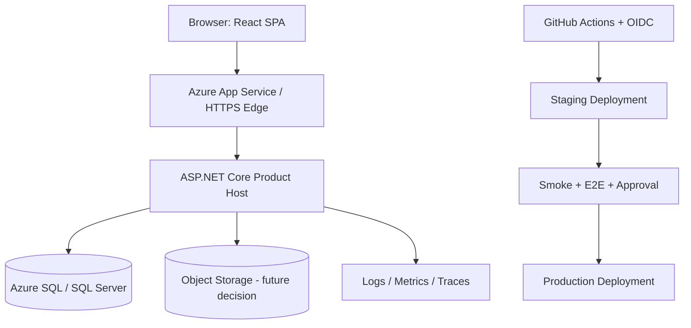

# 17. البنية التحتية والنشر وCI/CD (Infrastructure & Delivery)

## 17.1 النموذج المستهدف

MVP يستهدف Modular Monolith على .NET 10 مع ASP.NET Core API، React SPA على Same-Origin، SQL Server، واستضافة Azure App Service على Linux وفق قرار الاستضافة المسجل في وثيقة ADR المرجعية. هذه بنية مستهدفة وليست إثباتاً أن Production provisioned.

## 17.2 بيئات التشغيل

| البيئة | الغرض | بياناتها | الوصول |
|---|---|---|---|
| Local | التطوير والتجارب | seed/synthetic | المطور فقط |
| CI | Build/test/migrations | ephemeral SQL Server | workflow identity |
| Staging | إثبات deployment وe2e/recovery | بيانات synthetic أو masked | فريق محدود |
| Production | خدمة التجار والعملاء | بيانات حقيقية | least privilege + audit |

لا تنسخ Production data إلى Local/Staging دون masking وموافقة وسياسة احتفاظ.

## 17.3 Pipeline المستهدف

1. Pull Request validation: formatting/analyzers/build/unit tests.
2. SQL integration tests على SQL Server service/container.
3. Migration validation: generate script، apply upgrade على قاعدة مؤقتة، verify schema.
4. Playwright smoke/E2E ضمن suites المطلوبة للميزة.
5. Security/dependency scanning وsecret scanning.
6. Build immutable artifact مرة واحدة.
7. Deploy إلى Staging باستخدام OIDC وenvironment approvals.
8. Smoke tests وhealth/readiness، ثم acceptance.
9. Production deployment بعد موافقة release gate.
10. Post-deploy verification ومراقبة مؤشرات الخطأ.

الـ workflow الموجود في baseline يشغّل builds واختبارات Product وPoCs وPlaywright في CI وفق الملف الحالي؛ لا يوجد في snapshot الذي فُحص workflow نشر Azure إلى Production. ولا نملك نتيجة Run جديدة في هذه المراجعة، لذا لا يصح إعلان CI green حالياً.

## 17.4 Configuration & Secrets

- Configuration خارج الكود عبر Environment Variables/Configuration Provider.
- Secrets في Azure Key Vault أو App Service managed settings، مع Managed Identity عند الإمكان.
- لا تحفظ production connection strings أو private certificates في Git أو ملفات sample فعلية.
- فصل config per environment مع startup validation للإعدادات الحرجة.
- `AllowedHosts` explicit خارج Development.
- SQL encryption وTLS certificates حسب البيئة.
- OIDC federation لـ GitHub Actions بدلاً من client secret طويل العمر، مع صلاحيات Deployment محدودة.

## 17.5 Database Deployment

- EF Core migrations هي مصدر schema history؛ راجع كل migration وSQL generated.
- لا تشغّل migration تلقائياً من كل instance عند startup في Production دون خطة deployment واعتماد.
- استخدم migration job/step منفصل، ونسخة احتياطية قبل التغيير عالي المخاطر.
- اختبر upgrade من آخر release، والـ rollback/forward-fix؛ لا تفترض أن Down migration آمنة.
- التغييرات غير المتوافقة تتبع Expand-Migrate-Contract: أضف schema متوافقاً، انشر كوداً مزدوج القراءة/الكتابة عند الحاجة، رحّل البيانات، ثم أزل القديم بإصدار لاحق.

## 17.6 Deployment Architecture Diagram

ملاحظة: Object Storage وAzure SQL اختياران تصميميان يحتاجان تثبيتاً؛ قاعدة البيانات التي يثبتها الكود حالياً SQL Server connection contract واسم `RetailFlowProduct`، ولا يعني ذلك أن مورد Azure SQL قد أُنشئ.
