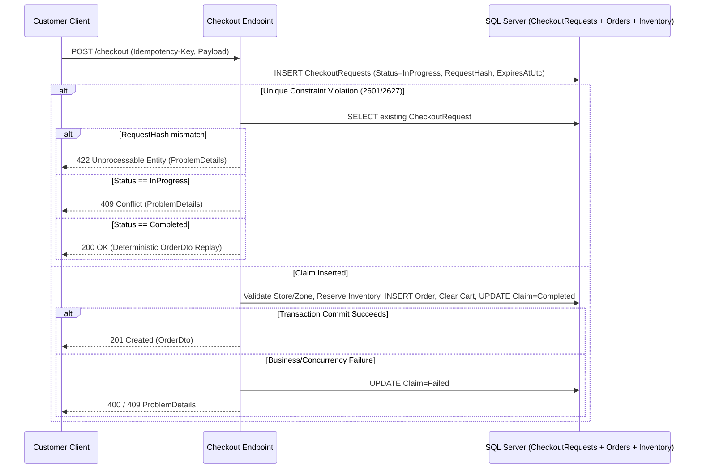

# ADR-0006 — Checkout Idempotency via Atomic Key Claim

| Field | Value |
|---|---|
| Status | Accepted |
| Date | 2026-11-26 |
| Owner | Product Owner & Principal Software Architect |
| Decision scope | Architecture / Data / Security / Reliability |
| Related requirements | `FR-030`, `FR-031`, `NFR-004`, `TX-01`, `INV-01`, `OR-09`, `UC-08`, `AUD-005`, `OD-008` |
| Supersedes | None |
| Superseded by | None |

## 1. Context
Audit finding `AUD-005` and open decision `OD-008` flagged that a naive check-then-insert idempotency check in Checkout is vulnerable to race conditions under concurrent retries (double-click, mobile network retry), risking duplicate orders or double inventory reservation. `ACTIVE-WORK.md` explicitly prohibits implementing Checkout before an owner-approved idempotency contract is in place.

## 2. Problem statement
How must `POST /api/stores/{slug}/checkout` guarantee at-most-once order creation and inventory reservation under concurrent duplicate requests while returning deterministic responses?

## 3. Decision drivers and constraints
- **Atomicity (`TX-01`):** No TOCTOU race between checking `Idempotency-Key` and reserving inventory / creating the order.
- **Tenant & actor isolation:** An `Idempotency-Key` from Store A or Customer A must never collide with or leak responses to Store B or Customer B.
- **Payload integrity:** Reusing the same `Idempotency-Key` with a different checkout payload must be rejected, not silently replayed.
- **Standards compliance (`REF-07`):** Error responses use RFC 9457 `ProblemDetails`.

## 4. Evidence and research
| Source | Authority/type | Version/date | Relevant claim | Applicability/limitations |
|---|---|---|---|---|
| EF Core 10 Transactions & Isolation (`https://learn.microsoft.com/en-us/ef/core/saving/transactions`) | Official | EF Core 10 | Explicit transactions + SQL Server unique constraints provide atomic duplicate detection | Note `AUD-03`: avoid `MultipleActiveResultSets=True` when using savepoints |
| RFC 9457 Problem Details (`https://www.rfc-editor.org/rfc/rfc9457`) | Standards / RFC | RFC 9457 | Standardized `application/problem+json` error payloads | Applied across `RetailFlow.Api` |
| IETF Draft — The `Idempotency-Key` HTTP Header Field | Standards draft | 2024 | Recommends `409 Conflict` for concurrent in-flight duplicates and `422 Unprocessable Content` for payload mismatch | Guides HTTP status mapping |

## 5. Options considered
- **Option A — Read-before-write check in Application code:** Query `CheckoutRequests` for `IdempotencyKey`, then insert if missing. *Rejected:* TOCTOU race under concurrent requests.
- **Option B — Distributed Redis lock only:** Adds external Redis dependency not in MVP Azure App Service + SQL Server stack. *Rejected:* unnecessary operational complexity.
- **Option C — Database-enforced atomic key claim (`CheckoutRequests` unique constraint + `RequestHash` + state machine) (Recommended):** Uses existing SQL Server transactional guarantees with zero extra infrastructure.

## 6. Decision
Recommend adopting an atomic `CheckoutRequests` claim protocol (keeping `Status: Proposed` until Gate 2 / `OD-008` approval):

1. **Schema (`CheckoutRequests`):**
   - Columns: `Id (PK)`, `StoreId`, `CustomerId`, `IdempotencyKey (nvarchar(128))`, `RequestHash (char(64) SHA-256)`, `Status (InProgress=1, Completed=2, Failed=3)`, `OrderId (nullable FK)`, `ResponseStatusCode (nullable int)`, `CreatedAtUtc`, `ExpiresAtUtc`.
   - Unique Index: `UX_CheckoutRequests_StoreId_CustomerId_IdempotencyKey (StoreId, CustomerId, IdempotencyKey)`.
2. **Request validation:**
   - Require `Idempotency-Key` header (non-empty, max 128 chars; missing -> `400 ValidationProblemDetails`).
   - Compute canonical SHA-256 `RequestHash` of `(StoreId, CustomerId, CartSnapshot/Items, FulfillmentMode, DeliveryZoneId, Address)`.
3. **Atomic claim & execution flow:**
   - **Step 1 (Claim):** Insert `CheckoutRequests` row with `Status = InProgress` and commit immediately in its own short transaction (or claim-first pattern).
   - **Step 2 (On Unique Constraint Violation `2601`/`2627`):** Read existing row for `(StoreId, CustomerId, IdempotencyKey)`:
     - If `RequestHash != currentRequestHash` -> return `422 Unprocessable Entity` (`ProblemDetails`, never replay).
     - If `Status == InProgress` -> return `409 Conflict` (`ProblemDetails`, concurrent request in flight).
     - If `Status == Completed` -> replay stored `201 Created` (`OrderId` / `OrderDto`).
     - If `Status == Failed` -> either return deterministic failure or allow retry only if explicitly marked retryable by policy.
   - **Step 3 (Execute Checkout Transaction):** Within a single SQL Server transaction (`Serializable` or `READ COMMITTED` with `InventoryItem` atomic conditional `UPDATE` / `RowVersion`), validate stock, decrement/reserve inventory (`IN-01`, `IN-02`), create `Order`, and update `CheckoutRequests` to `Status = Completed, OrderId = order.Id`. On unhandled failure before commit, mark `CheckoutRequests.Status = Failed` in a separate cleanup scope so the key does not stay stuck `InProgress`.

## 7. Sequence, Failure Windows & Lease Recovery (`RF-REV-003`)

### 7.1 Failure & Recovery Matrix (At-Most-Once Order Creation & Idempotent Replay)
Note: RetailFlow guarantees **at-most-once order creation and inventory reservation** per `(StoreId, CustomerId, IdempotencyKey)` plus **deterministic response replay**, not generic "exactly-once" side-effect execution across process crashes.

| Failure Window / Scenario | Handling & Recovery |
|---|---|
| 1. Claim inserted & committed; app crashes before checkout | Claim stays `InProgress` until lease expiry (`InProgressLeaseSeconds`, e.g. 60s–120s); concurrent retries receive `409 Conflict`; expired stale `InProgress` rows require atomic conditional reclaim (`UPDATE ... SET Status=InProgress, ExpiresAtUtc=@New WHERE Id=@Id AND Status=InProgress AND ExpiresAtUtc <= @Now`) — *recovery worker not yet implemented*. |
| 2. Checkout business validation or `RowVersion` fails | Claim is marked `Failed` in cleanup; retry with same key returns deterministic failure (non-retryable) or requires a fresh `Idempotency-Key`. |
| 3. Order + Inventory written; app crashes before claim marked `Completed` | Because Order creation, Inventory reservation, Cart clear, and `CheckoutRequest.MarkCompleted` execute in a single `SaveChangesAsync()` transaction, SQL Server rolls back all four atomically on crash before commit. |
| 4. Concurrent duplicate while first is executing | Second request hits `UX_CheckoutRequests_StoreId_CustomerId_IdempotencyKey` (`2601`/`2627`), reads `InProgress`, and returns `409 Conflict`. |
| 5. Retry with different payload | `RequestHash` (SHA-256) mismatch returns `422 Unprocessable Entity` (`ProblemDetails`). |
| 6. Replay by unauthorized actor / cross-tenant | Key is scoped to `(StoreId, CustomerId, IdempotencyKey)` and protected by `TenantClaimMatchEndpointFilter`, preventing cross-store or cross-customer replay. |

## 8. Consequences
- **Positive:** Eliminates duplicate orders under concurrency without external locking services; enforces tenant/customer scoping at the index level.
- **Negative:** Requires a short initial claim commit plus cleanup handling on unexpected process crash (mitigated by `ExpiresAtUtc` / stale `InProgress` recovery).
- **Follow-on work:** Remove `MultipleActiveResultSets=True` (`AUD-03`) from Product Host write connection strings if savepoints are used.

## 8. Security and tenant isolation
- Unique key includes `(StoreId, CustomerId, IdempotencyKey)` so one tenant or customer can never probe or replay another's checkout.
- `RequestHash` prevents key reuse with tampered cart items or delivery zone.

## 9. Implementation plan
- Do **not** implement `CheckoutRequests` or `POST /api/stores/{slug}/checkout` until Gate 2 (`AUD-004`, `AUD-005`), `OD-008`, and `AUTH-ADR-01` (`OD-006`) are approved.

## 10. Rollback / recovery
- Pure design ADR; no schema or code changes applied while `Proposed`.

## 11. Verification and acceptance
- Concurrent SQL integration test firing `N >= 5` parallel `POST /checkout` requests with the same `Idempotency-Key`: exactly 1 `Order` created, inventory reserved once, remaining requests return `409 Conflict` (while in-flight) or replay `201 Created` (after completion).
- Payload mismatch test: same `Idempotency-Key` with altered delivery zone or quantity returns `422 Unprocessable Entity`.

## 12. Approval
- Owner decision: Accepted
- Approved by: Project Owner (via interactive session decision)
- Approval date: 2026-11-26
- Evidence/reference: Session decision `2026-11-26T02:45:31+03:00`

## 13. Implementation status (separate from decision status)
- Not started (Blocked on Gate 2 approval, `OD-008`, and `AUTH-ADR-01`)
- Code paths: None
- Commit: N/A
- CI run: N/A
- Remaining gaps: Owner approval of `OD-008` and `ADR-0006`.
